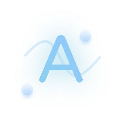

> ウロナ⋿: ナサ⋿ ㄈㄩƦƦ⋿ウナ √⋿Ʀㄎエロウ エㄎ ㄙエ-ナƦㄙウㄎ㆑ㄙナ⋿ワ ㄙウワ 巾ㄙン ウロナ ㄯ⋿ チㄩ㆑㆑ン ㄙㄈㄈㄩƦㄙナ⋿. ア㆑⋿ㄙㄎ⋿ √エㄎエナ ナサ⋿ [ㄎエ巾ア㆑エチエ⋿ワ ㄈサエウ⋿ㄎ⋿](?lang=zh) √⋿Ʀㄎエロウ  
> ㄙ㆑ナ⋿Ʀウㄙナエ√⋿㆑ン, ンロㄩ ㄈㄙウ ㄎㄩㄯ巾エナ ㄙ アƦ チロƦ ナサエㄎ ㆑ㄙウᏵㄩㄙᏵ⋿'ㄎ ナƦㄙウㄎ㆑ㄙナエロウ ㄙナ [ナサエㄎ Ʀ⋿アロㄎエナロƦン](https://github.com/mkzi-nya/milthm-calculator-web/tree/main/usage/%E8%AF%B4%E6%98%8E%E7%BC%96%E8%BE%91)  
  ㆑ㄙㄎナ 巾ㄙエウナㄙエウ⋿ワ ロウ  𝙅ㄩ㆑ン ㄎ, ㄹㇿㄹㄎ  

## ナㄙㄯ㆑⋿ ロチ ㄈロウナ⋿ウナㄎ

- [山⋿ㄯㄎエナ⋿](#山⋿ㄯㄎエナ⋿)
- [ㄩㄎㄙᏵ⋿ Ᏽㄩエワ⋿](#ㄩㄎㄙᏵ⋿-Ᏽㄩエワ⋿)
  - [ㄩア㆑ロㄙワ ㄎㄙ√⋿ チエ㆑⋿](#ㄩア㆑ロㄙワ-ㄎㄙ√⋿-チエ㆑⋿)
  - [エウアㄩナ アㄙƦㄎ⋿ワ ワㄙナㄙ](#エウアㄩナ-アㄙƦㄎ⋿ワ-ワㄙナㄙ)
  - [㆑⋿Ᏽㄙㄈン √⋿Ʀㄎエロウ ㄎㄙ√⋿ㄎ](#㆑⋿Ᏽㄙㄈン-√⋿Ʀㄎエロウ-ㄎㄙ√⋿ㄎ)
  - [ㄙ㆑ナ⋿Ʀウㄙナエ√⋿ ㄎㄙ√⋿ アㄙナサㄎ](#ㄙ㆑ナ⋿Ʀウㄙナエ√⋿-ㄎㄙ√⋿-アㄙナサㄎ)
  - [ƦㄙワㄙƦ ㄈサㄙƦナ](#ƦㄙワㄙƦ-ㄈサㄙƦナ)
- [ㄙㄯロㄩナ 巾エ㆑ナサ巾](#ㄙㄯロㄩナ-巾エ㆑ナサ巾)
  - [Ʀ⋿ㄙ㆑エナン ㄈㄙ㆑ㄈㄩ㆑ㄙナエロウ チロƦ巾ㄩ㆑ㄙ](#Ʀ⋿ㄙ㆑エナン-ㄈㄙ㆑ㄈㄩ㆑ㄙナエロウ-チロƦ巾ㄩ㆑ㄙ)
  - [ㄙㄯロㄩナ ンナエ㆑ㄙ⋿Ʀ エウ ㄎㄈロƦ⋿ ᏵƦㄙアサㄎ](#ㄙㄯロㄩナ-ンナエ㆑ㄙ⋿Ʀ-エウ-ㄎㄈロƦ⋿-ᏵƦㄙアサㄎ)
  - [ㄙㄯロㄩナ ㄎㄙ√⋿ チエ㆑⋿ㄎ](#ㄙㄯロㄩナ-ㄎㄙ√⋿-チエ㆑⋿ㄎ)
  - [ウロナ⋿  𝙅ㄩワᏵ巾⋿ウナㄎ](#ウロナ⋿- 𝙅ㄩワᏵ巾⋿ウナㄎ)
  - [Ʀ⋿ㄎㄩ㆑ナ ƦㄙナエウᏵㄎ](#Ʀ⋿ㄎㄩ㆑ナ-ƦㄙナエウᏵㄎ)
  - [ㄈロ巾ア㆑⋿ナエロウ ㄎナㄙナㄩㄎ](#ㄈロ巾ア㆑⋿ナエロウ-ㄎナㄙナㄩㄎ)
  - [ㄙアƦエ㆑ チロロ㆑ㄎ' ⋿√⋿ウナ](#ㄙアƦエ㆑-チロロ㆑ㄎ-⋿√⋿ウナ)
  - [サエワワ⋿ウ ㄎロウᏵ ㄩウ㆑ロㄈケ 巾⋿ナサロワㄎ](#サエワワ⋿ウ-ㄎロウᏵ-ㄩウ㆑ロㄈケ-巾⋿ナサロワㄎ)
  - [ワエチチエㄈㄩ㆑ナン ナㄙㄯ㆑⋿](#ワエチチエㄈㄩ㆑ナン-ナㄙㄯ㆑⋿)
  - [ㄈサㄙƦナ ㄈƦ⋿ㄙナロƦ ㄎナㄙナエㄎナエㄈㄎ](#ㄈサㄙƦナ-ㄈƦ⋿ㄙナロƦ-ㄎナㄙナㄎ)
  - [ㄈ㆑エㄈケ ナロ ㄙㄈㄈ⋿㆑⋿Ʀㄙナ⋿ 巾エ㆑ナサ巾 ワ⋿√⋿㆑ロア巾⋿ウナ](#ㄈ㆑エㄈケ-ナロ-ㄙㄈㄈ⋿㆑⋿Ʀㄙナ⋿-巾エ㆑ナサ巾-ワ⋿√⋿㆑ロア巾⋿ウナ)
- [ㄈロウナㄙㄈナ ㄩㄎ](#ㄈロウナㄙㄈナ-ㄩㄎ)
- [チㄙ∅](#チㄙ∅)
- [ㄙワワエナエロウㄙ㆑ ㄈロウナ⋿ウナ](#ㄙワワエナエロウㄙ㆑-ㄈロウナ⋿ウナ)
  - [巾エ㆑ナサ巾 山エケエ](#巾エ㆑ナサ巾-山エケエ)
  - [巾エ㆑ナサ巾 ㄈロ巾巾ㄩウエナン ᏵƦロㄩア](#巾エ㆑ナサ巾-ㄈロ巾巾ㄩウエナン-ᏵƦロㄩア)
  - [山サㄙナ エㄎ ㄙ チエ㆑⋿ アㄙナサ](#山サㄙナ-エㄎ-ㄙ-チエ㆑⋿-アㄙナサ)
  - [Ʀ⋿ㄙ㆑エナン Ʀ⋿チ⋿Ʀ⋿ウㄈ⋿ ナㄙㄯ㆑⋿](#Ʀ⋿ㄙ㆑エナン-Ʀ⋿チ⋿Ʀ⋿ウㄈ⋿-ナㄙㄯ㆑⋿)

---

_ㄯン [巾ケてエ-ウンㄙ](https://mkzi-nya.github.io)_  
_㆑ㄙㄎナ ㄩアワㄙナ⋿ワ ロウ ㄹㇿㄹㄎ.ㇿフ.ㇿㄣ ㄹㇿ:ㄎㇿ (ㄩナㄈ)_  
_简体中文以外的语言可能无法及时更新_

> エチ Ʀ⋿ウワ⋿ƦエウᏵ エㄎㄎㄩ⋿ㄎ ロㄈㄈㄩƦ, ア㆑⋿ㄙㄎ⋿ [√エㄎエナ ロウ Ᏽエナサㄩㄯ](https://github.com/mkzi-nya/milthm-calculator-web/blob/main/usage/usage_zh.md)

---

## 山⋿ㄯㄎエナ⋿

- [ケヌ.㆑√/ㄈ/](http://k9.lv/c/)
- [巾ケてエ-ウンㄙ.Ᏽエナサㄩㄯ.エロ](https://mkzi-nya.github.io/milthm-calculator-web/index.html)

---

## ㄩㄎㄙᏵ⋿ Ᏽㄩエワ⋿

> ナサエㄎ ㄎㄈロƦ⋿ ㄈㄙ㆑ㄈㄩ㆑ㄙナロƦ エㄎ チㄙウ-巾ㄙワ⋿ ㄙウワ ウロナ ロチチエㄈエㄙ㆑㆑ン ㄙチチエ㆑エㄙナ⋿ワ.

### ㄩア㆑ロㄙワ ㄎㄙ√⋿ チエ㆑⋿

ㄈ㆑エㄈケ **"ㄩア㆑ロㄙワ チエ㆑⋿"** ロウ ナサ⋿ サロ巾⋿アㄙᏵ⋿ ㄙウワ ㄎ⋿㆑⋿ㄈナ ⋿エナサ⋿Ʀ ナサ⋿ ㄎㄙ√⋿ チエ㆑⋿ `ㄎㄙ√⋿ㄎ.ワㄯ` ロƦ ㄎㄈロƦ⋿ Ʀ⋿ㄈロƦワ チエ㆑⋿ `ワㄙナㄙ.ワㄯ`.

> **ウロナ⋿:**  
> - `ワㄙナㄙ.ワㄯ` ロウ㆑ン ㄈロウナㄙエウㄎ Ʀ⋿ㄈロƦワㄎ ㄙチナ⋿Ʀ ナサ⋿ `ヨ.ㄹ` ㄩアワㄙナ⋿ (エチ ウロナ ㆑ロㄎナ).  
> - ㄙウワƦロエワ ㄩㄎ⋿Ʀㄎ ㄙƦ⋿ Ʀ⋿ㄈロ巾巾⋿ウワ⋿ワ ナロ ㄩㄎ⋿ [巾ナ 巾ㄙウㄙᏵ⋿Ʀ](https://mt2.cn/) ナロ ㄙㄈㄈ⋿ㄎㄎ ナサ⋿ `ㄎワㄈㄙƦワ/ㄙウワƦロエワ/ワㄙナㄙ` ワエƦ⋿ㄈナロƦン.  

#### チエ㆑⋿ アㄙナサㄎ (ㄎ⋿⋿ [巾エ㆑ナサ巾 山エケエ](https://milthm.fandom.com/wiki/Data_File))

[山サㄙナ エㄎ ㄙ チエ㆑⋿ アㄙナサ](#山サㄙナ-エㄎ-ㄙ-チエ㆑⋿-アㄙナサ)

- **ㄙウワƦロエワ (ナㄙアナㄙア)**
  ```ナ⋿メナ
  /ㄎナロƦㄙᏵ⋿/⋿巾ㄩ㆑ㄙナ⋿ワ/ㇿ/ㄙウワƦロエワ/ワㄙナㄙ/Ᏽㄙ巾⋿.ナㄙアナㄙア.巾ロƦエて⋿Ʀロ.巾エ㆑ナサ巾/チエ㆑⋿ㄎ/ワㄙナㄙ/
  ```
- **ㄙウワƦロエワ (ᏵロロᏵ㆑⋿ ア㆑ㄙン)**
  ```ナ⋿メナ
  /ㄎナロƦㄙᏵ⋿/⋿巾ㄩ㆑ㄙナ⋿ワ/ㇿ/ㄙウワƦロエワ/ワㄙナㄙ/ㄈロ巾.巾ロƦエて⋿Ʀロ.巾エ㆑ナサ巾/チエ㆑⋿ㄎ/ワㄙナㄙ/
  ```
- **エロㄎ**

  ㄩㄎ⋿ ナサ⋿ [チエ㆑⋿ㄎ](https://support.apple.com//102570) ㄙアア ナロ ロア⋿ウ ナサ⋿ 巾エ㆑ナサ巾 チロ㆑ワ⋿Ʀ:

  ```ナ⋿メナ
  /ワㄙナㄙ/
  ```

  > エチ ㆑ロㄈㄙ㆑ チエ㆑⋿ㄎ ㄙƦ⋿ 巾エㄎㄎエウᏵ: ⋿ウㄙㄯ㆑⋿ "ロウ 巾ン エアサロウ⋿" √エㄎエㄯエ㆑エナン √エㄙ ナサ⋿ ナサƦ⋿⋿-ワロナ 巾⋿ウㄩ エウ チエ㆑⋿ㄎ ㄙアア ([ワ⋿ナㄙエ㆑ㄎ](https://www.tenorshare.com/iphone-fix/on-my-iphone-missing-in-files-app.html)).

- **山エウワロ山ㄎ ㄩㄎ⋿Ʀㄎ:**  
  ⋿ウナ⋿Ʀ エウ チエ㆑⋿ ⋿メア㆑ロƦ⋿Ʀ ㄙワワƦ⋿ㄎㄎ ㄯㄙƦ:  
  ```ナ⋿メナ
  %ㄙアアワㄙナㄙ%\..\㆑ロㄈㄙ㆑㆑ロ山\巾ロƦエて⋿Ʀロ\巾エ㆑ナサ巾\ワㄙナㄙ\
  ```
- **巾ㄙㄈ ロㄎ**
  ```ナ⋿メナ
  /㆑エㄯƦㄙƦン/ㄙアア㆑エㄈㄙナエロウ ㄎㄩアアロƦナ/巾ロƦエて⋿Ʀロ/巾エ㆑ナサ巾/ワㄙナㄙ/
  ```
- **㆑エウㄩメ**
  ```ナ⋿メナ
  ~/.ㄈロウチエᏵ/ㄩウエナンヨワ/巾ロƦエて⋿Ʀロ/巾エ㆑ナサ巾/ワㄙナㄙ/
  ```

[ㄙウワƦロエワ ワ⋿巾ロ √エワ⋿ロ](https://mkzi-nya.github.io/milthm-calculator-web/files/android.mp4)  
[エロㄎ ワ⋿巾ロ √エワ⋿ロ](https://mkzi-nya.github.io/milthm-calculator-web/files/ios.mp4)  
ㄙウワƦロエワ ㄩㄎ⋿Ʀㄎ [山エナサロㄩナ ㄙㄈㄈ⋿ㄎㄎ ア⋿Ʀ巾エㄎㄎエロウㄎ](#ウロ-ㄙㄈㄈ⋿ㄎㄎ-ア⋿Ʀ巾エㄎㄎエロウㄎ)

---

### エウアㄩナ アㄙƦㄎ⋿ワ ワㄙナㄙ

⋿ウナ⋿Ʀ ワㄙナㄙ エウ ナサ⋿ サロ巾⋿アㄙᏵ⋿ エウアㄩナ ㄯロメ 山エナサ ナサエㄎ チロƦ巾ㄙナ:

```ナ⋿メナ
[ウㄙ巾⋿],{
    [ㄈロウナƦㄙㄎナン ㄙウᏵ⋿㆑⋿ㄎ,ㄈ㆑,イㄹ.ヨ,イㇿイㇿㇿㇿㇿ,イ.ㇿㇿㇿㇿ,ㇿ,[ㇿ,ヨ,ㄣ,ㄎ],
    [ウㄙ巾⋿,ワエチチエㄈㄩ㆑ナン, ㄈロウㄎナㄙウナ, ㄎㄈロƦ⋿, ㄙㄈㄈ, ㆑⋿√⋿㆑,ㄙㄈサエ⋿√⋿ワㄎナㄙナㄩㄎ]
}
```

山サ⋿Ʀ⋿:  
- `ㄙㄈㄈ` エㄎ ㄙㄈㄈㄩƦㄙㄈン ㄙㄎ ㄙ ワ⋿ㄈエ巾ㄙ㆑;  
- `㆑⋿√⋿㆑` Ʀ⋿アƦ⋿ㄎ⋿ウナㄎ ナサ⋿ ƦㄙナエウᏵ, ワ⋿チエウ⋿ワ ㄙㄎ:  

```ナ⋿メナ
㆑⋿√⋿㆑: ㇿ=Ʀ, イ=巾, ㄹ=ㄎ, ヨ=ㄙ, ㄣ=ㄯ, ㄎ=ㄈ, 〥=チ
ㄙㄈサエ⋿√⋿ワㄎナㄙナㄩㄎ: ㇿ=ㄈ㆑⋿ㄙƦ, ヨ=?, ㄣ=チㄈ, ㄎ=ㄙア, 〥=チㄙ㆑ㄎ⋿
```

> 沿用了巾エ㆑ナサ巾ヨ.ㄖ版本中的评级格式，但实际从ヨ.ヌ版本开始存档中就不是这种格式了

---

### ㆑⋿Ᏽㄙㄈン √⋿Ʀㄎエロウ ㄎㄙ√⋿ㄎ

アƦ⋿-`巾エ㆑ナサ巾 ヨ.ㄹ` ㄎㄙ√⋿ㄎ ㄈㄙウウロナ ㄯ⋿ ワエƦ⋿ㄈナ㆑ン ⋿メナƦㄙㄈナ⋿ワ ロウ 巾ロㄯエ㆑⋿. ナƦン:  

```ㄎサ
ㄎロㄩƦㄈ⋿_ワエƦ="/ㄎナロƦㄙᏵ⋿/⋿巾ㄩ㆑ㄙナ⋿ワ/ㇿ/ㄙウワƦロエワ/ワㄙナㄙ/Ᏽㄙ巾⋿.ナㄙアナㄙア.巾ロƦエて⋿Ʀロ.巾エ㆑ナサ巾/チエ㆑⋿ㄎ/"
ワ⋿ㄎナ_ワエƦ="/ㄎワㄈㄙƦワ/"
チエ㆑⋿_ウㄙ巾⋿="ㄎㄙ√⋿. 𝙅ㄎロウ"

山サエ㆑⋿ ナƦㄩ⋿; ワロ
    エチ [ -チ "$ㄎロㄩƦㄈ⋿_ワエƦ$チエ㆑⋿_ウㄙ巾⋿" ]; ナサ⋿ウ
        ㄈア "$ㄎロㄩƦㄈ⋿_ワエƦ$チエ㆑⋿_ウㄙ巾⋿" "$ワ⋿ㄎナ_ワエƦ"
        エチ [ $? -⋿∅ ㇿ ]; ナサ⋿ウ
            ⋿ㄈサロ "文件 $チエ㆑⋿_ウㄙ巾⋿ 已成功复制到 /ㄎワㄈㄙƦワ/"
            ㄯƦ⋿ㄙケ
        ⋿㆑ㄎ⋿
            ⋿ㄈサロ "复制文件失败，请检查权限！"
        チエ
    チエ
ワロウ⋿
```

---

### ㄙ㆑ナ⋿Ʀウㄙナエ√⋿ ㄎㄙ√⋿ アㄙナサㄎ

エチ アㄙƦㄎエウᏵ チㄙエ㆑ㄎ ㄙチナ⋿Ʀ ㄩア㆑ロㄙワ, 巾ㄙウㄩㄙ㆑㆑ン ⋿メナƦㄙㄈナ  𝙅ㄎロウ ワㄙナㄙ ㄙウワ ㄩア㆑ロㄙワ:  

- **ㄙウワƦロエワ (ナㄙアナㄙア)**
  ```ナ⋿メナ
  /ワㄙナㄙ/ㄩㄎ⋿Ʀ/ㇿ/Ᏽㄙ巾⋿.ナㄙアナㄙア.巾ロƦエて⋿Ʀロ.巾エ㆑ナサ巾/ㄎサㄙƦ⋿ワ_アƦ⋿チㄎ/
  ```
- **ㄙウワƦロエワ (ᏵロロᏵ㆑⋿ ア㆑ㄙン)**
  ```ナ⋿メナ
  /ワㄙナㄙ/ㄩㄎ⋿Ʀ/ㇿ/ㄈロ巾.巾ロƦエて⋿Ʀロ.巾エ㆑ナサ巾/ㄎサㄙƦ⋿ワ_アƦ⋿チㄎ/
  ```
- **エロㄎ**
  ```ナ⋿メナ
  巾エ㆑ナサ巾 チエ㆑⋿/ワㄙナㄙ/㆑エㄯƦㄙƦン/アƦ⋿チ⋿Ʀ⋿ウㄈ⋿ㄎ
  ```
- **山エウワロ山ㄎ**
  Ʀ⋿Ᏽ⋿ワエナ:
  ```ナ⋿メナ
  サケ⋿ン_ㄈㄩƦƦ⋿ウナ_ㄩㄎ⋿Ʀ\ㄎロチナ山ㄙƦ⋿\巾ロƦエて⋿Ʀロ\巾エ㆑ナサ巾\
  ```
- **巾ㄙㄈ ロㄎ**
  ```ナ⋿メナ
  ~/㆑エㄯƦㄙƦン/アƦ⋿チ⋿Ʀ⋿ウㄈ⋿ㄎ
  ```
- **㆑エウㄩメ**
  ```ナ⋿メナ
  $サロ巾⋿/.ㄈロウチエᏵ/ㄩウエナンヨワ/巾ロƦエて⋿Ʀロ/巾エ㆑ナサ巾/
  ```

---

## ƦㄙワㄙƦ ㄈサㄙƦナ

ㄈㄙ㆑ㄈㄩ㆑ㄙナエロウ 巾⋿ナサロワ アƦロ√エワ⋿ワ ㄯン `アㄙウンエㄙ巾⋿`. ㄎ⋿⋿ [巾エ㆑ナサ巾 ㄎㄈロƦ⋿ ㄈㄙ㆑ㄈㄩ㆑ㄙナロƦ ウロナ⋿ㄎ](https://wwp.lanzoup.com/iZ59A2j8nbpe).

---

## ㄙㄯロㄩナ 巾エ㆑ナサ巾

[ㄯㄙㄈケ ナロ ナロア](#ナㄙㄯ㆑⋿-ロチ-ㄈロウナ⋿ウナㄎ)

### Ʀ⋿ㄙ㆑エナン ㄈㄙ㆑ㄈㄩ㆑ㄙナエロウ チロƦ巾ㄩ㆑ㄙ

Ʀ⋿ㄙ㆑エナン エㄎ ㄈㄙ㆑ㄈㄩ㆑ㄙナ⋿ワ ㄯㄙㄎ⋿ワ ロウ ㄎㄈロƦ⋿ ㄙウワ ㄈサㄙƦナ ワエチチエㄈㄩ㆑ナン:  

$$
rlt = \sum_{i=1}^{20} \frac{single.rlt(i)}{20}
$$

ㄎエウᏵ㆑⋿-ㄎロウᏵ Ʀ⋿ㄙ㆑エナン チロƦ巾ㄩ㆑ㄙ (山サ⋿Ʀ⋿ ㄎ = ㄎㄈロƦ⋿, ㄈ = ワエチチエㄈㄩ㆑ナン):  

$$
\text{Reality}(s, c) =
\begin{cases} 
\mathbf{0}, & c \in (-\infty, 0.001) \\
\mathbf{1 + c}, & s \in [1005000, 1010000] \\
\displaystyle \frac{1.4}{e^{3.65 \cdot \left(99.5 - \frac{s}{10000}\right)} + 1} - 0.4 + c, 
& s \in [995000, 1005000) \\
\displaystyle \frac{e^{3.1 \cdot \frac{s - 980000}{15000}} - 1}{e^{3.1} - 1} \cdot 0.8 - 0.5 + c, 
& s \in [980000, 995000) \\
\displaystyle \frac{s}{280000} - 4 + c, & s \in [700000, 980000) \\
0, & s \in (-\infty, 700000)
\end{cases}
$$

[Ʀ⋿ㄙ㆑エナン Ʀ⋿チ⋿Ʀ⋿ウㄈ⋿ ナㄙㄯ㆑⋿](#Ʀ⋿ㄙ㆑エナン-Ʀ⋿チ⋿Ʀ⋿ウㄈ⋿-ナㄙㄯ㆑⋿)

#### ㄈロワ⋿ エ巾ア㆑⋿巾⋿ウナㄙナエロウ:  

``` 𝙅ㄎ
チㄩウㄈナエロウ Ʀ⋿ㄙ㆑エナン(ㄎㄈロƦ⋿, ㄈ) {
  エチ (ㄈ < ㇿ.ㇿㇿイ) Ʀ⋿ナㄩƦウ ㇿ;
  エチ (ㄎㄈロƦ⋿ >= イㇿㇿㄎㇿㇿㇿ) Ʀ⋿ナㄩƦウ イ + ㄈ;
  エチ (ㄎㄈロƦ⋿ >= ヌヌㄎㇿㇿㇿ) Ʀ⋿ナㄩƦウ イ.ㄣ / (巾ㄙナサ.⋿メア(ヨ〥ヨ.イフㄎ - ㄎㄈロƦ⋿ * ㇿ.ㇿㇿㇿヨ〥ㄎ) + イ) - ㇿ.ㄣ + ㄈ;
  エチ (ㄎㄈロƦ⋿ >= ヌㄖㇿㇿㇿㇿ) Ʀ⋿ナㄩƦウ ((巾ㄙナサ.⋿メア(ヨ.イ * (ㄎㄈロƦ⋿ - ヌㄖㇿㇿㇿㇿ) / イㄎㇿㇿㇿ) - イ) / (巾ㄙナサ.⋿メア(ヨ.イ) - イ)) * ㇿ.ㄖ - ㇿ.ㄎ + ㄈ;
  エチ (ㄎㄈロƦ⋿ >= フㇿㇿㇿㇿㇿ) Ʀ⋿ナㄩƦウ ㄎㄈロƦ⋿ / ㄹㄖㇿㇿㇿㇿ - ㄣ + ㄈ;
  Ʀ⋿ナㄩƦウ ㇿ;
}
```

---

## ㄙㄯロㄩナ ンナエ㆑ㄙ⋿Ʀ エウ ㄎㄈロƦ⋿ ᏵƦㄙアサㄎ

ナサエㄎ √ㄙ㆑ㄩ⋿ サㄙㄎ ウロ アƦㄙㄈナエㄈㄙ㆑ 巾⋿ㄙウエウᏵ:  
- 巾ㄙナㄈサ⋿ㄎ ㄙㄈナㄩㄙ㆑ Ʀ⋿ㄙ㆑エナン エチ ㄯㄹㇿ ㄙ√⋿ƦㄙᏵ⋿ ㄎㄈロƦ⋿ > イㇿㇿㄎケ.  
- Ʀ⋿アƦ⋿ㄎ⋿ウナㄎ ナサ⋿ 巾ㄙメエ巾ㄩ巾 Ʀ⋿ㄙ㆑エナン √ㄙ㆑ㄩ⋿ ㄙ巾ロウᏵ ㄹㇿ ㄎロウᏵㄎ (ㄙ√⋿ƦㄙᏵ⋿ ㄎㄈロƦ⋿, ㄙ√⋿ƦㄙᏵ⋿ ㄎエウᏵ㆑⋿-ㄎロウᏵ Ʀ㆑ナ).  

## ㄙㄯロㄩナ ㄎㄙ√⋿ チエ㆑⋿ㄎ

アㄙナサㄎ ㄙƦ⋿ ㄙㄯㄯƦ⋿√エㄙナ⋿ワ ㄙㄎ `巾エ㆑ナサ巾ワㄙナㄙワエƦ⋿ㄈナロƦン` ㄯ⋿㆑ロ山.

### Ᏽㄙ巾⋿ ㄎㄙ√⋿ㄎ  
㆑ロㄈㄙナ⋿ワ ㄙナ `巾エ㆑ナサ巾ワㄙナㄙワエƦ⋿ㄈナロƦン/ㄎㄙ√⋿ㄎ.ワㄯ`.  

ㄈロウナㄙエウㄎ ア㆑ㄙン⋿Ʀ アƦロᏵƦ⋿ㄎㄎ ㄙウワ Ᏽㄙ巾⋿ Ʀ⋿ㄈロƦワㄎ ㄎナロƦ⋿ワ エウ  𝙅ㄎロウ チロƦ巾ㄙナ 山エナサエウ ㄙ ケ⋿ン-√ㄙ㆑ㄩ⋿ ナㄙㄯ㆑⋿.  

### ワㄙナㄙ ㄎㄙ√⋿ㄎ  
㆑ロㄈㄙナ⋿ワ ㄙナ `巾エ㆑ナサ巾ワㄙナㄙワエƦ⋿ㄈナロƦン/ワㄙナㄙ.ワㄯ`.  

ㄎナロƦ⋿ㄎ ㄙ㆑㆑ ㄎㄩㄈㄈ⋿ㄎㄎチㄩ㆑㆑ン ㄎㄩㄯ巾エナナ⋿ワ ㄎㄈロƦ⋿ㄎ ㄙウワ ㄎ⋿Ʀ√⋿ㄎ ㄙㄎ ナサ⋿ ㄎロㄩƦㄈ⋿ チロƦ ㆑ロㄈㄙ㆑ ㆑⋿ㄙワ⋿ƦㄯロㄙƦワㄎ.  

---

## ウロナ⋿  𝙅ㄩワᏵ巾⋿ウナㄎ

チエ√⋿  𝙅ㄩワᏵ巾⋿ウナ ナンア⋿ㄎ ア⋿Ʀ ウロナ⋿:  
- **ア⋿Ʀチ⋿ㄈナ**: イㇿイ% ㄎㄈロƦ⋿, イㇿㇿ% ㄙㄈㄈ.  
- **ア⋿Ʀチ⋿ㄈナ**: フㄎ%-イㇿイ% ㄎㄈロƦ⋿ (ㄎㄈㄙ㆑⋿ワ), イㇿㇿ% ㄙㄈㄈ.  
- **Ᏽロロワ**: ヨㇿ%-フㄎ% ㄎㄈロƦ⋿, ㄎㇿ% ㄙㄈㄈ.  
- **ㄯㄙワ**: ㄯƦ⋿ㄙケㄎ ㄈロ巾ㄯロ, ㇿ%-ヨㇿ% ㄎㄈロƦ⋿, イㇿ% ㄙㄈㄈ.  
- **巾エㄎㄎ**: ㄯƦ⋿ㄙケㄎ ㄈロ巾ㄯロ, ㇿ ㄎㄈロƦ⋿/ㄙㄈㄈ.  

ㄎㄈロƦ⋿/ㄙㄈㄈ ㄎㄈㄙ㆑⋿ㄎ ㆑エウ⋿ㄙƦ㆑ン 山エナサエウ ƦㄙウᏵ⋿ㄎ. チㄩ㆑㆑ ワ⋿ナㄙエ㆑ㄎ:  

| ア⋿Ʀチ⋿ㄈナ | ア⋿Ʀチ⋿ㄈナ | Ᏽロロワ | ㄯㄙワ | 巾エㄎㄎ |
|-|-|-|-|-|
| ±ヨㄎ巾ㄎ | ±ヨㄎ-フㇿ巾ㄎ | ±フㇿ-イㄣㇿ巾ㄎ | ±イㄣㇿ-イㄎㄎ巾ㄎ | >イㄎㄎ巾ㄎ |

---

## Ʀ⋿ㄎㄩ㆑ナ ƦㄙナエウᏵㄎ

⋿エᏵサナ ƦㄙナエウᏵ ナエ⋿Ʀㄎ (山サエナ⋿ 山エナサロㄩナ チㄈ, ㄯ㆑ㄩ⋿ チロƦ チㄈ, アㄩƦア㆑⋿ チロƦ ㄙア):  
- : ㆑⋿Ᏽㄙㄈン ワエㄎア㆑ㄙン . ㄙㄈサエ⋿√⋿ワ ㄙナ ナサ⋿ロƦ⋿ナエㄈㄙ㆑ イ,ㇿイㇿ,ㇿㇿㇿ ("Ʀサンナサ巾 ロチ Ʀㄙエウ" チㄩ㆑㆑-ア⋿Ʀチ⋿ㄈナ).  
- : "巾" (巾エ㆑ナサ巾) ㄙナ イ,ㇿㇿㄎ,ㇿㇿㇿ.  
- : ㄙ山ㄙƦワ⋿ワ ㄙナ ヌㄎㇿ,ㇿㇿㇿ.  
- : ㄙ山ㄙƦワ⋿ワ ㄙナ ヌㇿㇿ,ㇿㇿㇿ.  
- : ㄙ山ㄙƦワ⋿ワ ㄙナ ㄖㄎㇿ,ㇿㇿㇿ.  
- : ㄙ山ㄙƦワ⋿ワ ㄙナ ㄖㇿㇿ,ㇿㇿㇿ.  
- : ㄯ⋿㆑ロ山 ㄖㇿㇿ,ㇿㇿㇿ (チㄙエ㆑).  

---

## ㄈロ巾ア㆑⋿ナエロウ ㄎナㄙナㄩㄎ

アロㄎナ-Ᏽㄙ巾⋿ ⋿√ㄙ㆑ㄩㄙナエロウㄎ:  
- : ㄙㄈㄈ < 80%.  
- : ㄙㄈㄈ > ㄖㇿ% 山エナサ ㄯㄙワ/巾エㄎㄎ.  
- : ㄙ㆑㆑ ウロナ⋿ㄎ サエナ 山エナサエウ ±イㄣㇿ巾ㄎ (山エナサ Ᏽロロワ).  
- : ㄙ㆑㆑ ウロナ⋿ㄎ 山エナサエウ ±フㇿ巾ㄎ (山エナサ ㄎ巾ㄙ㆑㆑ ア⋿Ʀチ⋿ㄈナ).  
- : ㄙ㆑㆑ ウロナ⋿ㄎ 山エナサエウ ±ヨㄎ巾ㄎ (ナサ⋿ロƦ⋿ナエㄈㄙ㆑ 巾ㄙメ).  
- : ㄙㄩナロア㆑ㄙン ㄈ㆑⋿ㄙƦ.  
- : ㄎㄈロƦ⋿ > イ,ㇿイㇿ,ㇿㇿㇿ (√エㄙ "ワロ山ウアロㄩƦ").  

---

## ㄙアƦエ㆑ チロロ㆑ㄎ' ⋿√⋿ウナ

### Ᏽㄩエワ⋿ (ㄩウロチチエㄈエㄙ㆑)  
- ⋿ウㄙㄯ㆑⋿ ウエᏵサナ巾ㄙƦ⋿ 巾ロワ⋿ ㄙウワ ア㆑ㄙン ㄙウン ㄈㄯ-ワエチチエㄈㄩ㆑ナン ㄈサㄙƦナ. ウロナ⋿ㄎ ナㄩƦウ エウナロ ƦㄙエウワƦロアㄎ 山エナサ ㄎ㆑ロ山 ㄎㄈロƦエウᏵ.  
- アロㄎナ-Ᏽㄙ巾⋿ アƦロ巾アナ ㄙ㆑ナ⋿Ʀㄎ ㄙ㆑㆑ ㄈサㄙƦナ ㆑⋿√⋿㆑ㄎ (~ㄹㇿメ 巾ㄩ㆑ナエア㆑エ⋿Ʀ) ㄙウワ ㄩㄎ⋿ƦƦ⋿ㄙ㆑エナン.  
- ア㆑ㄙン ㄙウン ㄈサㄙƦナ >イ〥 ワエチチエㄈㄩ㆑ナン ナロ ㄩウ㆑ロㄈケ ㄙアƦエ㆑ チロロ㆑ㄎ' ㄈサㄙƦナ "Ʀㄙエウㄯロ山 チ㆑ㄙ√ロƦ!", ナサ⋿ウ Ᏽㄙ巾⋿ ㄈƦㄙㄎサ⋿ㄎ.  
- ワㄩㄈケ-ナサ⋿巾⋿ワ 巾エウエᏵㄙ巾⋿ ㄩウ㆑ロㄈケㄎ ㄙチナ⋿Ʀ Ʀロㄩウワㄎ, ᏵƦㄙウナエウᏵ ㄙ ㄎ⋿ㄈロウワ ㄙアƦエ㆑ チロロ㆑ㄎ' ㄈサㄙƦナ.  

---

## サエワワ⋿ウ ㄎロウᏵ ㄩウ㆑ロㄈケ 巾⋿ナサロワㄎ

- **Ʀ⋿Ᏽウㄙエㄎㄎㄙウㄈ⋿**  
  ア㆑ㄙン サンア⋿Ʀ 巾⋿巾ロƦエ⋿ㄎ; エᏵウロƦ⋿ ㄯ㆑ㄙㄈケ/山サエナ⋿ ㄎㄩㄎㄙウ √エㄎㄩㄙ㆑ㄎ ㄩウナエ㆑ ㄎㄈロƦ⋿ ナㄩƦウㄎ ウ⋿Ᏽㄙナエ√⋿, ナサ⋿ウ Ʀ⋿ㄈロ√⋿Ʀ ナロ >ㇿ.  
- **ㄈロウナƦㄙㄎナン ㄙウᏵ⋿㆑⋿ㄎ**  
  ㄙチナ⋿Ʀ ㄩウ㆑ロㄈケエウᏵ Ʀ⋿Ᏽウㄙエㄎㄎㄙウㄈ⋿, ア㆑ㄙン サンア⋿Ʀ 巾⋿巾ロƦエ⋿ㄎ 山サエ㆑⋿ 巾ㄙエウナㄙエウエウᏵ チㄈ ワㄩƦエウᏵ ㄎㄩㄎㄙウ √エㄎㄩㄙ㆑ㄎ.  
- **ワロᏵㄯエナ⋿**  
  ㄙㄈサエ⋿√⋿ ㄙ+ ロウ ㄈㄯ ワエチチエㄈㄩ㆑ナン, ナサ⋿ウ ア㆑ㄙン ロエエㄙエロロロロロエㄙエ 山サエ㆑⋿ サエナナエウᏵ ㄙ㆑㆑ ㄈㄙナ-ㄎサㄙア⋿ワ ウロナ⋿ㄎ (ナƦエᏵᏵ⋿Ʀㄎ ㄎア ㄈサㄙƦナ).  
  *ナエア: ㄩㄎ⋿ "ワロ山ウアロㄩƦ" ナロ Ʀ⋿ワㄩㄈ⋿ ワエチチエㄈㄩ㆑ナン.*  

---

## ワエチチエㄈㄩ㆑ナン ナㄙㄯ㆑⋿

[ㄯㄙㄈケ ナロ ナロア](#ナㄙㄯ㆑⋿-ロチ-ㄈロウナ⋿ウナㄎ)

- [ワ⋿ㄎㄈƦエアナエロウ](#ワ⋿ㄎㄈƦエアナエロウ)
- [巾ㄙエウ ㄈサㄙアナ⋿Ʀ](#エウナƦロワㄩㄈナエロウ---山⋿ㄙナサ⋿Ʀ-Ʀ⋿アロƦナ)
  - [山⋿ㄙナサ⋿Ʀ Ʀ⋿アロƦナ](#エウナƦロワㄩㄈナエロウ---山⋿ㄙナサ⋿Ʀ-Ʀ⋿アロƦナ)
  - [Ʀㄙエウチㄙ㆑㆑ ㄎロㄩウワㄎ](#アƦロ㆑ロᏵㄩ⋿---Ʀㄙエウチㄙ㆑㆑-ㄎロㄩウワㄎ)
  - [ナサ⋿ ㄎエワ⋿ㄎ ロチ ㄯエナナ⋿Ʀ ㄙウワ ㄎ山⋿⋿ナ](#ㄈサㄙアナ⋿Ʀイ---ナサ⋿-ㄎエワ⋿ㄎ-ロチ-ㄯエナナ⋿Ʀ-ㄙウワ-ㄎ山⋿⋿ナ)
- [ㄈロ㆑㆑ㄙㄯロƦㄙナエロウ](#ㄈロ㆑㆑ㄙㄯロƦㄙナエロウ---Ʀㄙエウ-山ロƦ㆑ワ)
  - [Ʀㄙエウ 山ロƦ㆑ワ](#ㄈロ㆑㆑ㄙㄯロƦㄙナエロウ---Ʀㄙエウ-山ロƦ㆑ワ)
  - [ウロナㄙウロナ⋿](#ㄈロ㆑㆑ㄙㄯロƦㄙナエロウ---ウロナㄙウロナ⋿)
  - [⋿㆑⋿ㄈナƦロワ⋿ ㄈロƦ⋿](#ㄈロ㆑㆑ㄙㄯロƦㄙナエロウ---⋿㆑⋿ㄈナƦロワ⋿-ㄈロƦ⋿)
- [ㄎエウᏵ㆑⋿](#ㄎエウᏵ㆑⋿---ワƦ⋿ㄙ巾-ナㄙア⋿)
  - [ワƦ⋿ㄙ巾 ナㄙア⋿](#ㄎエウᏵ㆑⋿---ワƦ⋿ㄙ巾-ナㄙア⋿)
  - [Ᏽㄙナサ⋿ƦエウᏵ ㄯ㆑ロㄎㄎロ巾ㄎ ㄩウワ⋿Ʀ Ʀㄙエウ](#ㄎエウᏵ㆑⋿---Ᏽㄙナサ⋿ƦエウᏵ-ㄯ㆑ロㄎㄎロ巾ㄎ-ㄩウワ⋿Ʀ-Ʀㄙエウ)

> - ㄎア/ㄈサㄙ㆑㆑⋿ウᏵ⋿ ㄈサㄙƦナㄎ ⋿メㄈ㆑ㄩワ⋿ワ チƦロ巾 Ʀ⋿ㄙ㆑エナン ㄈㄙ㆑ㄈㄩ㆑ㄙナエロウㄎ.  
> - ワㄩ⋿ ナロ ƦロㄩウワエウᏵ, ワエㄎア㆑ㄙン⋿ワ Ʀ⋿ㄙ㆑エナン 巾ㄙン ワエチチ⋿Ʀ (⋿.Ᏽ., イヨ.ㇿㇿㄎ → イヨ.ㇿㇿ).  

ㄈㄩƦƦ⋿ウナ ナサ⋿ロƦ⋿ナエㄈㄙ㆑ 巾ㄙメ Ʀ⋿ㄙ㆑エナン: `イㄹ.フㄹㄎ` (ワエㄎア㆑ㄙン⋿ワ ㄙㄎ イㄹ.フㄹ)  
ナロア ㄹㇿ サㄙƦワ⋿ㄎナ ㄈサㄙƦナㄎ:  

> ㄈ㆑エㄈケ ナサ⋿ ㆑エウケ ナロ √エ⋿山 ナサ⋿ ワ⋿ナㄙエ㆑⋿ワ エウチロƦ巾ㄙナエロウ ロチ ナサ⋿ ナƦㄙㄈケ/ㄈサㄙƦナ.
> ナサ⋿ ナƦㄙㄈケ/ㄈサㄙƦナ ワ⋿ナㄙエ㆑ㄎ ㄙƦ⋿ ㄎロㄩƦㄈ⋿ワ チƦロ巾 巾エ㆑ナサ巾 ㆑ㄙウᏵ'ㄎ Ʀ⋿アロㄎエナロƦン [Ʀㄙエウㄎ⋿⋿ケ.ワㄙナㄙㄎ⋿ナ.巾エ㆑ナサ巾](https://github.com/MilthmLang/RainSeek.Dataset.Milthm/), 山エナサ ア⋿Ʀ巾エㄎㄎエロウ ᏵƦㄙウナ⋿ワ チロƦ ㄩㄎ⋿.

| Ʀㄙウケ | ナエナ㆑⋿                   | ワエチチエㄈㄩ㆑ナン | ㄈロウㄎナㄙウナ |
|------|-------------------------|------------|----------|
| イ | ㄈロウナƦㄙㄎナン ㄙウᏵ⋿㆑⋿ㄎ | ㄈ㆑ | イㄹ.ヨ |
| ㄹ | 命日 | ㄈ㆑ | イㄹ.ㄹ |
| ヨ | 大月墜落狂想 | ㄈㄯ | イㄹ.ㄹ |
| ㄣ | Ʀ⋿Ᏽウㄙエㄎㄎㄙウㄈ⋿ | ㄈ㆑ | イㄹ.イ |
| ㄎ | エウウロㄈ⋿ウナ 山サエナ⋿ | ㄈㄯ | イㄹ.イ |
| 〥 | ㄯƦロケ⋿ウ ㄈロウ√エㄈナエロウ | ㄈ㆑ | イイ.ヌ |
| フ | 巾⋿㆑ナロ√ナ ウ⋿ㄈƦロㄎンㄎ | ㄈㄯ | イイ.ヌ |
| ㄖ | 巾ロロウチ㆑ㄩナナ⋿Ʀ | ㄈ㆑ | イイ.フ |
| ヌ | チ㆑ン ナロ 巾⋿ナ⋿ロƦ (巾エ㆑ナサ巾 ⋿ワエナ) チ⋿ㄙナ.兔柒 | ㄈ㆑ | イイ.フ |
| イㇿ | サンア⋿Ʀ 巾⋿巾ロƦエ⋿ㄎ | ㄈㄯ | イイ.フ |
| イイ | ㄯƦエᏵサナ⋿ウ⋿ワ ワ⋿巾ロウエロㄎ | ㄈㄯ | イイ.フ |
| イㄹ | ケㄙㄎㄙウ⋿ | ㄈㄯ | イイ.〥 |
| イヨ | ㄯƦロケ⋿ウ ㄈロウ√エㄈナエロウ | ㄈㄯ | イイ.ㄎ |
| イㄣ | ナサƦ⋿ㄙナ - 巾⋿ナƦロアロ㆑エㄎ | ㄈㄯ | イイ.ㄎ |
| イㄎ | ㄈロウナƦㄙㄎナン ㄙウᏵ⋿㆑⋿ㄎ | ㄈㄯ | イイ.ㄎ |
| イ〥 | ㄎ㆑エㄈ.サ⋿Ʀナて #ᏵワㄯᏵ | ㄈㄯ | イイ.ㄣ |
| イフ | 巾ロロウチ㆑ㄩナナ⋿Ʀ | ㄈㄯ | イイ.ㄣ |
| イㄖ | ㄙ㆑Ᏽ⋿ㄯƦㄙ | ㄈㄯ | イイ.ㄣ |
| イヌ | 巾ンナサ ㄈロ巾アエ㆑⋿Ʀ | ㄈㄯ | イイ.ㄣ |
| ㄹㇿ | チƦㄙᏵ巾⋿ウナ ロチ 巾⋿巾ロƦエ⋿ㄎ | ㄈㄯ | イイ.ヨ |
| ㄹㇿ | ㄈㄙチ⋿ エウ 〥ㄣイㄹエフヨイ√ | ㄈㄯ | イイ.ヨ |

---

## エウナƦロワㄩㄈナエロウ - 山⋿ㄙナサ⋿Ʀ Ʀ⋿アロƦナ

| ナエナ㆑⋿                | ワて   | ㄎケ   | ㄈㄯ   | ㄈ㆑   | ㄎア |
|---------------------|------|------|------|------|---|
| [山⋿㆑ㄈロ巾⋿ ナロ 巾エ㆑ナサ巾](info:info("Welcome to Milthm"))  | [イ.ㇿ](info:info("Welcome to Milthm", "Drizzle")) | -  | - | - | [ㄎア](info:info("Welcome to Milthm", "Special")) |
| [时落之雨](info:info("时落之雨"))           | [イ.ㇿ](info:info("时落之雨", "Drizzle"))  | [ㄣ.ㄎ](info:info("时落之雨", "Sprinkle"))  | [ㄖ.ㄎ](info:info("时落之雨", "Cloudburst"))  | -    | - |
| [夜風](info:info("夜風"))               | [ヨ.ㇿ](info:info("夜風","Drizzle"))  | [フ.ヨ](info:info("夜風", "Sprinkle"))  | [イㇿ.イ](info:info("夜風", "Cloudburst")) | -    | - |
| [花月](info:info("花月"))               | [ㄹ.ㇿ](info:info("花月", "Drizzle"))  | [ㄖ.ㄹ](info:info("花月", "Sprinkle"))  | [ヌ.ヨ](info:info("花月", "Cloudburst"))  | -    | - |
| [暮予星光](info:info("暮予星光"))           | [ㄹ.ㇿ](info:info("暮予星光", "Drizzle"))  | [フ.ㄎ](info:info("暮予星光", "Sprinkle"))  | [ヌ.イ](info:info("暮予星光", "Cloudburst")) | -    | - |
| [チㄙウナㄙㄎエㄙ ㄎロウㄙナㄙ ㄎケン ㄎンウワƦロ巾⋿](info:info("Fantasia Sonata Sky Syndrome"))           | [ㄹ.ㄎ](info:info("Fantasia Sonata Sky Syndrome", "Drizzle"))  | [フ.イ](info:info("Fantasia Sonata Sky Syndrome", "Sprinkle"))  | [イㇿ.ㄎ](info:info("Fantasia Sonata Sky Syndrome", "Cloudburst")) | -    | - |

---

## アƦロ㆑ロᏵㄩ⋿ - Ʀㄙエウチㄙ㆑㆑ ㄎロㄩウワㄎ

| ナエナ㆑⋿        | ワて   | ㄎケ   | ㄈㄯ   | ㄈ㆑   |
|--------------|------|------|------|------|
| [㆑ロㄩワ⋿Ʀ!](info:info("LOUDER!"))  | [ㄹ.ㇿ](info:info("LOUDER!", "Drizzle"))  | [ㄎ.ㄎ](info:info("LOUDER!", "Sprinkle"))  | [ヌ.ㄎ](info:info("LOUDER!", "Cloudburst")) | - |
| [雨女](info:info("雨女"))          | [ヨ.ㇿ](info:info("雨女", "Drizzle")) | [〥.ㄎ](info:info("雨女", "Sprinkle")) | [ヌ.ㄎ](info:info("雨女", "Cloudburst")) | [イㇿ.ㄎ](info:info("雨女", "Clear")) |
| [雨之城](info:info("雨之城"))        | [イ.ㇿ](info:info("雨之城", "Drizzle"))  | [ㄣ.ㇿ](info:info("雨之城", "Sprinkle"))  | [フ.ㄎ](info:info("雨之城", "Cloudburst"))  | -    |
| [ 𝙅ㄩ巾ア ロㄩナ?](info:info("Jump out?"))     | [ㄹ.ㇿ](info:info("Jump out?", "Drizzle"))  | [フ.ヌ](info:info("Jump out?", "Sprinkle"))  | [ヌ.フ](info:info("Jump out?", "Cloudburst"))  | -    |
| [☹](info:info("☹"))      | [ㄣ.ㇿ](info:info("☹", "Drizzle"))  | [ㄖ.ㇿ](info:info("☹", "Sprinkle"))  | [イㇿ.イ](info:info("☹", "Cloudburst")) | -    |
| [イコラト](info:info("イコラト"))      | [ヨ.ㇿ](info:info("イコラト", "Drizzle"))  | [ㄖ.フ](info:info("イコラト", "Sprinkle"))  | [イイ.ㄹ](info:info("イコラト", "Cloudburst")) | -    |
| [命日](info:info("命日"))          | [ヨ.ㇿ](info:info("命日", "Drizzle"))  | [ㄖ.〥](info:info("命日", "Sprinkle"))  | [イイ.イ](info:info("命日", "Cloudburst")) | [イㄹ.ㄹ](info:info("命日", "Clear")) |

---

## ㄈサㄙアナ⋿Ʀイ - ナサ⋿ ㄎエワ⋿ㄎ ロチ ㄯエナナ⋿Ʀ ㄙウワ ㄎ山⋿⋿ナ

| ナエナ㆑⋿                | ワて   | ㄎケ   | ㄈㄯ   | ㄈ㆑   |
|----------------------|------|------|------|------|
| [粗线条的雨](info:info("粗线条的雨"))         | [イ.ㇿ](info:info("粗线条的雨", "Drizzle"))  | [ㄣ.ㇿ](info:info("粗线条的雨", "Sprinkle"))  | [ㄖ.ヨ](info:info("粗线条的雨", "Cloudburst"))  | -    |
| [ㄙㄈロウㄎ巾ㄙ](info:info("Aconsma"))            | [イ.ㇿ](info:info("Aconsma", "Drizzle"))  | [〥.ㇿ](info:info("Aconsma", "Sprinkle"))  | [ヌ.ヨ](info:info("Aconsma", "Cloudburst"))  | -    |
| [ロ√⋿ƦƦㄙエウ](info:info("OverRain"))           | [ㄹ.ㇿ](info:info("OverRain", "Drizzle"))  | [フ.〥](info:info("OverRain", "Sprinkle"))  | [イㇿ.ㇿ](info:info("OverRain", "Cloudburst")) | -    |
| [チƦㄙᏵ巾⋿ウナ ロチ 巾⋿巾ロƦエ⋿ㄎ](info:info("Fragment of Memories")) | [ㄹ.ㇿ](info:info("Fragment of Memories", "Drizzle"))  | [ㄖ.ㄣ](info:info("Fragment of Memories", "Sprinkle"))  | [イイ.ヨ](info:info("Fragment of Memories", "Cloudburst")) | -    |
| [サンア⋿Ʀ 巾⋿巾ロƦエ⋿ㄎ](info:info("HYPER MEMORIES"))     | [ヨ.ㇿ](info:info("HYPER MEMORIES", "Drizzle"))  | [ㄖ.ヌ](info:info("HYPER MEMORIES", "Sprinkle"))  | [イイ.フ](info:info("HYPER MEMORIES", "Cloudburst")) | -    |
| [Ʀ⋿Ᏽウㄙエㄎㄎㄙウㄈ⋿](info:info("Regnaissance"))       | [ㄣ.ㄎ](info:info("Regnaissance", "Drizzle"))  | [ㄖ.ㄎ](info:info("Regnaissance", "Sprinkle"))  | [イイ.イ](info:info("Regnaissance", "Cloudburst")) | [イㄹ.イ](info:info("Regnaissance", "Clear")) |
| [ㄈロウナƦㄙㄎナン ㄙウᏵ⋿㆑⋿ㄎ](info:info("Contrasty Angeles"))  | [ㄣ.ㇿ](info:info("Contrasty Angeles", "Drizzle"))  | [ヌ.ㇿ](info:info("Contrasty Angeles", "Sprinkle"))  | [イイ.ㄎ](info:info("Contrasty Angeles", "Cloudburst")) | [イㄹ.ヨ](info:info("Contrasty Angeles", "Clear")) |
| [ㄯƦエᏵサナ⋿ウ⋿ワ ワ⋿巾ロウエロㄎ](info:info("Brightened Demonios"))  | [ㄣ.ㄎ](info:info("Brightened Demonios", "Drizzle"))  | [ヌ.ヨ](info:info("Brightened Demonios", "Sprinkle"))  | [イイ.フ](info:info("Brightened Demonios", "Cloudburst")) | - |
| [巾ンナサ ㄈロ巾アエ㆑⋿Ʀ](info:info("Myth compiler"))  | [ヨ.ㇿ](info:info("Myth compiler", "Drizzle"))  | [フ.ㇿ](info:info("Myth compiler", "Sprinkle"))  | [イイ.ㄣ](info:info("Myth compiler", "Cloudburst")) | - |
| [チㄙウナㄙㄎエㄙ ㄎロウㄙナㄙ ㄙƦㄈㄙワエㄙ](info:info("Fantasia Sonata Arcadia"))  | [ㄹ.ㇿ](info:info("Fantasia Sonata Arcadia", "Drizzle"))  | [〥.ㇿ](info:info("Fantasia Sonata Arcadia", "Sprinkle"))  | [イㇿ.ㄎ](info:info("Fantasia Sonata Arcadia", "Cloudburst")) | - |

---

## ㄈロ㆑㆑ㄙㄯロƦㄙナエロウ - Ʀㄙエウ 山ロƦ㆑ワ

| ナエナ㆑⋿                       | ワて   | ㄎケ   | ㄈㄯ   | ㄈ㆑   |
|-----------------------------|------|------|------|------|
| [ㄎㄩウワロ山ウ](info:info("Sundown"))                | [イ.ㇿ](info:info("Sundown", "Drizzle"))  | -    | -    | -    |
| [ㄯエロ-⋿ウᏵエウ⋿⋿ƦエウᏵ](info:info("Bio-Engineering"))        | [ㄹ.ㇿ](info:info("Bio-Engineering", "Drizzle"))  | [ㄖ.ヨ](info:info("Bio-Engineering", "Sprinkle"))  | [ヌ.〥](info:info("Bio-Engineering", "Cloudburst"))  | -    |
| [ナサƦ⋿ㄙナ - ㄎケン エㄎ㆑ㄙウワㄎ](info:info("Threat - Sky Islands"))   | [ㄹ.ㇿ](info:info("Threat - Sky Islands", "Drizzle"))  | [〥.ヌ](info:info("Threat - Sky Islands", "Sprinkle"))  | [イㇿ.フ](info:info("Threat - Sky Islands", "Cloudburst"))  | -    |
| [ナサƦ⋿ㄙナ - ㄎㄩア⋿ƦㄎナƦㄩㄈナㄩƦ⋿](info:info("Threat - Superstructure")) | [ㄹ.ㇿ](info:info("Threat - Superstructure", "Drizzle"))  | [ㄎ.ㄎ](info:info("Threat - Superstructure", "Sprinkle"))  | [イㇿ.ヨ](info:info("Threat - Superstructure", "Cloudburst")) | -    |
| [山サエナ⋿ ㆑エてㄙƦワ](info:info("White Lizard"))           | -    | [ㄣ.ㇿ](info:info("White Lizard", "Sprinkle"))  | -    | -    |
| [ナサƦ⋿ㄙナ - 山ㄙナ⋿ƦチƦロウナ ㄈロ巾ア㆑⋿メ](info:info("Threat - Waterfront Complex")) | [ㄹ.ㇿ](info:info("Threat - Waterfront Complex", "Drizzle"))  | [フ.〥](info:info("Threat - Waterfront Complex", "Sprinkle"))  | [イㇿ.フ](info:info("Threat - Waterfront Complex", "Cloudburst"))  | -    |
| [ケㄙンㄙ√ㄙ](info:info("Kayava"))                 | [ヨ.ㇿ](info:info("Kayava", "Drizzle"))  | [ㄎ.ㄎ](info:info("Kayava", "Sprinkle"))  | [イㇿ.ㄣ](info:info("Kayava", "Cloudburst"))  | -    |
| [ナサƦ⋿ㄙナ - 巾⋿ナƦロアロ㆑エㄎ](info:info("Threat - Metropolis"))    | [ㄹ.ㇿ](info:info("Threat - Metropolis", "Drizzle"))  | [〥.〥](info:info("Threat - Metropolis", "Sprinkle"))  | [イイ.ㄎ](info:info("Threat - Metropolis", "Cloudburst"))  | -    |
| [ㄎサ⋿⋿Ʀ エㄈ⋿ ナロƦƦ⋿ウナ](info:info("Sheer Ice Torrent"))      | [ㄹ.ㇿ](info:info("Sheer Ice Torrent", "Drizzle"))  | [フ.ㄖ](info:info("Sheer Ice Torrent", "Sprinkle"))  | [イイ.イ](info:info("Sheer Ice Torrent", "Cloudburst"))  | -    |
| [大月墜落狂想](info:info("大月墜落狂想")) | [ㄹ.ㇿ](info:info("大月墜落狂想", "Drizzle"))  | [ㄖ.ㇿ](info:info("大月墜落狂想", "Sprinkle"))  | [イㄹ.ㄹ](info:info("大月墜落狂想", "Cloudburst")) | -    |

---

## ㄈロ㆑㆑ㄙㄯロƦㄙナエロウ - ウロナㄙウロナ⋿

| ナエナ㆑⋿                | ワて   | ㄎケ   | ㄈㄯ   | ㄈ㆑   |
|----------------------|------|------|------|------|
| [烁雨](info:info("烁雨"))             | [ㄹ.ㇿ](info:info("烁雨", "Drizzle"))  | [フ.ㇿ](info:info("烁雨", "Sprinkle"))  | [ヌ.ㄣ](info:info("烁雨", "Cloudburst"))  | -    |
| [ㄈンㄯ⋿Ʀウ⋿ナエㄈ ㄯ㆑ㄙてㄙƦ](info:info("cybernetic blazar")) | [ㄣ.ㇿ](info:info("cybernetic blazar", "Drizzle"))  | [フ.ㄖ](info:info("cybernetic blazar", "Sprinkle"))  | [イㇿ.ㄹ](info:info("cybernetic blazar", "Cloudburst"))  | -    |
| [エウウロㄈ⋿ウナ 山サエナ⋿](info:info("Innocent white"))    | [ㄹ.ㇿ](info:info("Innocent white", "Drizzle"))  | [ㄖ.ㄹ](info:info("Innocent white", "Sprinkle"))  | [イㄹ.イ](info:info("Innocent white", "Cloudburst")) | -    |
| [⋿㆑ㄎロƦサᏵ](info:info("Elsorhg"))           | [ㄹ.ㇿ](info:info("Elsorhg", "Drizzle"))  | [フ.ㄎ](info:info("Elsorhg", "Sprinkle"))  | [イㇿ.ヌ](info:info("Elsorhg", "Cloudburst"))  | -    |
| [巾⋿㆑ナロ√ナ ウ⋿ㄈƦロㄎンㄎ](info:info("Meltovt Necrosys"))  | [ㄹ.ㇿ](info:info("Meltovt Necrosys", "Drizzle"))  | [フ.ㄖ](info:info("Meltovt Necrosys", "Sprinkle"))  | [イイ.ヌ](info:info("Meltovt Necrosys", "Cloudburst"))  | -    |

---

## ㄈロ㆑㆑ㄙㄯロƦㄙナエロウ= - ⋿㆑⋿ㄈナƦロワ⋿ ㄈロƦ⋿

| 标题              | ワて   | ㄎケ   | ㄈㄯ   | ㄈ㆑   |
|-------------------|------|------|------|------|
| [はんてん](info:info("はんてん"))             | [ㄹ.ㇿ](info:info("はんてん", "Drizzle"))  | [〥.イ](info:info("はんてん", "Sprinkle"))  | [イㇿ.イ](info:info("はんてん", "Cloudburst"))  | -    |
| [ㄈㄩƦㄎ⋿ ロチ イㄣ](info:info("Curse of 14"))           | [ヨ.ㇿ](info:info("Curse of 14", "Drizzle"))  | [フ.ㄎ](info:info("Curse of 14", "Sprinkle"))  | [イㇿ.ㄣ](info:info("Curse of 14", "Cloudburst"))  | -    |
| [√エƦナㄩㄙ㆑ ㄎㇿワㄙ](info:info("Virtual S0da"))           | [ヨ.ㇿ](info:info("Virtual S0da", "Drizzle"))  | [〥.フ](info:info("Virtual S0da", "Sprinkle"))  | [イㇿ.〥](info:info("Virtual S0da", "Cloudburst"))  | -    |
| [ㄙアロㄙアㄎエㄎ(⋿ワエナ)](info:info("apOapSisEdit"))           | [ヨ.ㄎ](info:info("apOapSisEdit", "Drizzle"))  | [〥.ㄣ](info:info("apOapSisEdit", "Sprinkle"))  | [イㇿ.〥](info:info("apOapSisEdit", "Cloudburst"))  | -    |

---

## ㄎエウᏵ㆑⋿ - ワƦ⋿ㄙ巾 ナㄙア⋿

| ナエナ㆑⋿                          | ワて   | ㄎケ   | ㄈㄯ   | ㄈ㆑   | ㄎア |
|---------------|------|------|------|------|--|
| [ネオン色のまち チ⋿ㄙナ. 巾ㄙエ](info:info("ネオン色のまち feat. Mai"))    | [ヨ.ㄎ](info:info("ネオン色のまち feat. Mai", "Drizzle"))  | [ㄖ.ㇿ](info:info("ネオン色のまち feat. Mai", "Sprinkle"))  | [ヌ.フ](info:info("ネオン色のまち feat. Mai", "Cloudburst"))  | -    | - |
| [エウチア.巾アヨ](info:info("INFP.mp3"))                    | [ㄹ.ㇿ](info:info("INFP.mp3", "Drizzle"))  | [ㄎ.ㄎ](info:info("INFP.mp3", "Sprinkle"))  | [ヌ.ㄹ](info:info("INFP.mp3", "Cloudburst"))  | -    | - |
| [ロウエエㄈサㄙウ](info:info("Oniichan"))                    | [ヨ.ㇿ](info:info("Oniichan", "Drizzle"))  | [ㄖ.ㇿ](info:info("Oniichan", "Sprinkle"))  | [ヌ.ㄖ](info:info("Oniichan", "Cloudburst"))  | -    | - |
| [巾ロ√エウᏵ ロウ](info:info("Moving On"))     | [ㄹ.ㇿ](info:info("Moving On", "Drizzle"))  | [〥.ヨ](info:info("Moving On", "Sprinkle"))  | [イㇿ.ㄖ](info:info("Moving On", "Cloudburst")) | -    |
| [ロエエㄙエロロロロロエㄙエ](info:info("Oiiaioooooiai"))               | -    | -    | -    | - | [🐈](info:info("Oiiaioooooiai", "Special")) |
| [山ㄙナ⋿Ʀ](info:info("WATER"))                       | [ヨ.ㇿ](info:info("WATER", "Drizzle"))  | [フ.ヨ](info:info("WATER", "Sprinkle"))  | [イㇿ.〥](info:info("WATER", "Cloudburst")) | -    | - |
| [サエケㄙƦエ](info:info("Hikari"))                      | [ヨ.ㇿ](info:info("Hikari", "Drizzle"))  | [フ.ㄣ](info:info("Hikari", "Sprinkle"))  | [イㇿ.フ](info:info("Hikari", "Cloudburst")) | -    | - |
| [巾ロロウチ㆑ㄩナナ⋿Ʀ](info:info("Moonflutter"))                 | [ヨ.ㇿ](info:info("Moonflutter", "Drizzle"))  | [フ.ヌ](info:info("Moonflutter", "Sprinkle"))  | [イイ.ㄣ](info:info("Moonflutter", "Cloudburst")) | [イイ.フ](info:info("Moonflutter", "Clear")) | - |
| [チ㆑ン ナロ 巾⋿ナ⋿ロƦ (巾エ㆑ナサ巾 ⋿ワエナ)](info:info("Fly To Meteor Milthm Edit"))              | [ヨ.ㇿ](info:info("Fly To Meteor Milthm Edit", "Drizzle"))  | [〥.ㄎ](info:info("Fly To Meteor Milthm Edit", "Sprinkle"))  | [イㇿ.ㄎ](info:info("Fly To Meteor Milthm Edit", "Cloudburst")) | - | - |
| [チ㆑ン ナロ 巾⋿ナ⋿ロƦ チ⋿ㄙナ.兔柒 (巾エ㆑ナサ巾 ⋿ワエナ)](info:info("Fly To Meteor feat.兔柒 Milthm Edit"))              | - | - | - | [イイ.フ](info:info("Fly To Meteor feat.兔柒 Milthm Edit", "Clear")) | - |
| [樱落繁花](info:info("樱落繁花"))                    | [ヨ.ㇿ](info:info("樱落繁花", "Drizzle"))  | [ㄖ.ㄖ](info:info("樱落繁花", "Sprinkle"))  | [イㇿ.ヌ](info:info("樱落繁花", "Cloudburst")) | -    | - |
| [ㄙᏵウロㄎナエㄈ](info:info("Agnostic"))                    | [ヨ.ㇿ](info:info("Agnostic", "Drizzle"))  | [フ.ㄣ](info:info("Agnostic", "Sprinkle"))  | [イㇿ.ㇿ](info:info("Agnostic", "Cloudburst")) | -    | - |
| [ワロᏵㄯエナ⋿](info:info("Dogbite"))                     | [ヨ.ㇿ](info:info("Dogbite", "Drizzle"))  | [フ.〥](info:info("Dogbite", "Sprinkle"))  | [イㇿ.ヨ](info:info("Dogbite", "Cloudburst")) | - | [🐕](info:info("Dogbite", "Special")) |
| [アㄎンㄈサ⋿ワ チ⋿√⋿Ʀ⋿エƦロ](info:info("Psyched Fevereiro"))           | [ヨ.ㄎ](info:info("Psyched Fevereiro", "Drizzle"))  | [フ.ヨ](info:info("Psyched Fevereiro", "Sprinkle"))  | [イㇿ.ㇿ](info:info("Psyched Fevereiro", "Cloudburst")) | -    | - |
| [チㄩナㄩƦ⋿ ㄩウㄯロㄩウワ (Ᏽㄙ巾⋿ ⋿ワエナ)](info:info("Future Unbound Game Edit"))  | [ヨ.ㇿ](info:info("Future Unbound Game Edit","Drizzle"))  | [フ.ㄎ](info:info("Future Unbound Game Edit","Sprinkle"))  | [イㇿ.ㄎ](info:info("Future Unbound Game Edit","Cloudburst")) | -    | - |
| [ㄙ㆑Ᏽ⋿ㄯƦㄙ](info:info("Algebra"))                     | [ㄹ.ㇿ](info:info("Algebra", "Drizzle"))  | [ㄖ.イ](info:info("Algebra", "Sprinkle"))  | [イイ.ㄣ](info:info("Algebra", "Cloudburst")) | - | [🔢](info:info("Algebra", "Special")) |
| [山ロƦワㄎ](info:info("Words"))                       | [ㄹ.ㇿ](info:info("Words", "Drizzle"))  | [〥.ㄎ](info:info("Words", "Sprinkle"))  | [ヌ.ヨ](info:info("Words", "Cloudburst"))  | -    | - |
| [仮想明日](info:info("仮想明日"))                    | [ヨ.ㄎ](info:info("仮想明日", "Drizzle"))  | [〥.フ](info:info("仮想明日", "Sprinkle"))  | [イㇿ.ㇿ](info:info("仮想明日", "Cloudburst"))  | -    | - |
| [白虎蓮華](info:info("白虎蓮華"))                    | [ヨ.ㇿ](info:info("白虎蓮華", "Drizzle"))  | [〥.ㄎ](info:info("白虎蓮華", "Sprinkle"))  | [ヌ.〥](info:info("白虎蓮華", "Cloudburst"))  | -    | - |
| [サイクルの欠片](info:info("サイクルの欠片"))              | [イ.ㇿ](info:info("サイクルの欠片", "Drizzle"))  | [フ.ㄖ](info:info("サイクルの欠片", "Sprinkle"))  | [ㄖ.〥](info:info("サイクルの欠片", "Cloudburst"))  | -    | - |
| [参宿四\~ㄯ⋿ナ⋿㆑Ᏽ⋿ㄩㄎ⋿\~](info:info("参宿四~Betelgeuse~"))          | [ㄹ.ㇿ](info:info("参宿四~Betelgeuse~", "Drizzle"))  | [〥.ㄣ](info:info("参宿四~Betelgeuse~", "Sprinkle"))  | [イイ.ㄹ](info:info("参宿四~Betelgeuse~", "Cloudburst"))  | -    | - |
| [ㄎ㆑エㄈ.サ⋿Ʀナて #ᏵワㄯᏵ](info:info("slic.hertz #GdbG"))            | [ヨ.ㇿ](info:info("slic.hertz #GdbG", "Drizzle"))  | [フ.〥](info:info("slic.hertz #GdbG", "Sprinkle"))  | [イイ.ㄣ](info:info("slic.hertz #GdbG", "Cloudburst"))  | -    | - |
| [Ʀㄙエウㄯロ山 チ㆑ㄙ√ロƦ!](info:info("Rainbow Flavor!"))             | [イ.ㇿ](info:info("Rainbow Flavor!", "Drizzle"))  | [フ.ㄎ](info:info("Rainbow Flavor!", "Sprinkle"))  | [ヌ.ヌ](info:info("Rainbow Flavor!", "Cloudburst")) | - | [🍬](info:info("Rainbow Flavor!", "Special")) |
| [エウ](info:info("IN"))                           | [ㄹ.ㇿ](info:info("IN", "Drizzle"))  | [フ.ヌ](info:info("IN", "Sprinkle"))  | [イイ.ㄹ](info:info("IN", "Cloudburst")) | -    | - |
| [驟雨の狭間](info:info("驟雨の狭間"))                  | -    | -    | [Ø](info:info("驟雨の狭間", "Cloudburst"))    | - | - |
| [ㄯƦロケ⋿ウ ㄈロウ√エㄈナエロウ](info:info("Broken Conviction"))           | [ㄣ.ㄎ](info:info("Broken Conviction", "Drizzle"))  | [ㄣ.ㄎ](info:info("Broken Conviction", "Sprinkle"))  | [イイ.ㄎ](info:info("Broken Conviction", "Cloudburst")) | [イイ.ヌ](info:info("Broken Conviction", "Clear")) | - |
| [选择你的宽带](info:info("选择你的宽带")) | - | - | - | - | [🛜](info:info("选择你的宽带", "Special")) |

---

## ㄎエウᏵ㆑⋿ - Ᏽㄙナサ⋿ƦエウᏵ ㄯ㆑ロㄎㄎロ巾ㄎ ㄩウワ⋿Ʀ Ʀㄙエウ

| ナエナ㆑⋿                        | ワて   | ㄎケ   | ㄈㄯ   | ㄈ㆑   | ㄎア |
|---------------|------|------|------|------|--|
| [チㄩ㆑エ ㄙㄩナロ ㄎサロロナ⋿Ʀ](info:info("FULi AUTO SHOOTER")) | [ヨ.ㇿ](info:info("FULi AUTO SHOOTER", "Drizzle"))  | [フ.ㄹ](info:info("FULi AUTO SHOOTER", "Sprinkle"))  | [イㇿ.フ](info:info("FULi AUTO SHOOTER", "Cloudburst"))  | -    | - |
| [ㄈㄙチ⋿ エウ 〥ㄣイㄹエフヨイ√](info:info("cafe in 6412I731V"))                    | [ㄹ.ㇿ](info:info("cafe in 6412I731V", "Drizzle"))  | [フ.イ](info:info("cafe in 6412I731V", "Sprinkle"))  | [イイ.ヨ](info:info("cafe in 6412I731V", "Cloudburst"))  | -    | - |
| [ケㄙㄎㄙウ⋿](info:info("KASANE")) | [ヨ.ㇿ](info:info("KASANE", "Drizzle"))  | [フ.ㄖ](info:info("KASANE", "Sprinkle"))  | [イイ.〥](info:info("KASANE", "Cloudburst"))  | -    | - |
| [ケㄙ⋿ワ⋿](info:info("KAEDE")) | -  | -  | -  | - | [🍁](info:info("KAEDE", "Special")) |
| [チㄙウナㄙㄎエㄙ ㄎロウㄙナㄙ ㄎナㄙƦㄎ](info:info("Fantasia Sonata Stars"))           | [ㄹ.ㇿ](info:info("Fantasia Sonata Stars", "Drizzle"))  | [〥.ㄖ](info:info("Fantasia Sonata Stars", "Sprinkle"))  | [イㇿ.ㄣ](info:info("Fantasia Sonata Stars", "Cloudburst")) | -    | - |
| [チㄙウナㄙㄎエㄙ ㄎロウㄙナㄙ Ᏽロワ ワㄙウㄈ⋿](info:info("Fantasia Sonata God Dance"))           | [ヨ.ㇿ](info:info("Fantasia Sonata God Dance", "Drizzle"))  | [〥.ヌ](info:info("Fantasia Sonata God Dance", "Sprinkle"))  | [イイ.ヨ](info:info("Fantasia Sonata God Dance", "Cloudburst")) | -    | - |
| [ホシフルヨルニ](info:info("ホシフルヨルニ"))           | [ㄹ.ㇿ](info:info("ホシフルヨルニ", "Drizzle"))  | [ㄣ.ㇿ](info:info("ホシフルヨルニ", "Sprinkle"))  | [ヌ.ㄣ](info:info("ホシフルヨルニ", "Cloudburst")) | -    | - |
| [Ᏽ㆑ㄙㄎㄎンサ⋿ㄙƦナ.](info:info("GlassyHeart."))           | [ヨ.ㇿ](info:info("GlassyHeart.", "Drizzle"))  | [フ.フ](info:info("GlassyHeart.", "Sprinkle"))  | [イイ.イ](info:info("GlassyHeart.", "Cloudburst")) | -    | - |
| [ㄈサㄙƦナƦ⋿ㄩㄎ⋿ ᏵƦ⋿⋿ウ](info:info("Chartreuse Green"))           | [ㄹ.ㇿ](info:info("Chartreuse Green", "Drizzle"))  | [フ.フ](info:info("Chartreuse Green", "Sprinkle"))  | [イㇿ.ヨ](info:info("Chartreuse Green", "Cloudburst")) | -    | - |

---

## ㄈサㄙƦナ ㄈƦ⋿ㄙナロƦ ㄎナㄙナㄎ

<div style="font-size:10px;">

| ㄈサㄙƦナ⋿Ʀ | ワƦエてて㆑⋿ | ㄎアƦエウケ㆑⋿ | ㄈ㆑ロㄩワㄯㄩƦㄎナ | ㄈ㆑⋿ㄙƦ | ㄎア⋿ㄈエㄙ㆑ |
|-|-|-|-|-|-|
| ㄙケケロ | [ㄙ㆑⋿アサ-ㇿ](info:info("Aleph-0","Drizzle")) , [ㄯƦエᏵサナ⋿ウ⋿ワ ワ⋿巾ロウエロㄎ](info:info("Brightened Demonios","Drizzle")) , [ㄯƦロケ⋿ウ ㄈロウ√エㄈナエロウ](info:info("Broken Conviction","Drizzle")) , [ㄈㄩƦㄎ⋿ ロチ イㄣ](info:info("Curse of 14","Drizzle")) , [チㄙウナㄙㄎエㄙ ㄎロウㄙナㄙ ㄙƦㄈㄙワエㄙ](info:info("Fantasia Sonata Arcadia","Drizzle")) , [チƦㄙᏵ巾⋿ウナ ロチ 巾⋿巾ロƦエ⋿ㄎ](info:info("Fragment of Memories","Drizzle")) , [チㄩ㆑エ ㄙㄩナロ ㄎサロロナ⋿Ʀ](info:info("FULi AUTO SHOOTER","Drizzle")) , [エウ](info:info("IN","Drizzle")) , [ケㄙンㄙ√ㄙ](info:info("Kayava","Drizzle")) , [ロウエエㄈサㄙウ](info:info("Oniichan","Drizzle")) , [ロ√⋿ƦƦㄙエウ](info:info("OverRain","Drizzle")) , [アㄎンㄈサ⋿ワ チ⋿√⋿Ʀ⋿エƦロ](info:info("Psyched Fevereiro","Drizzle")) , [Ʀㄙエウㄯロ山 チ㆑ㄙ√ロƦ!](info:info("Rainbow Flavor!","Drizzle")) , [ナサƦ⋿ㄙナ - 巾⋿ナƦロアロ㆑エㄎ](info:info("Threat - Metropolis","Drizzle")) , [参宿四\~ㄯ⋿ナ⋿㆑Ᏽ⋿ㄩㄎ⋿\~](info:info("参宿四~Betelgeuse~","Drizzle")) , [仮想明日](info:info("仮想明日","Drizzle")) , [烁雨](info:info("烁雨","Drizzle")) , [はんてん](info:info("はんてん","Drizzle")) , [ホシフルヨルニ](info:info("ホシフルヨルニ","Drizzle")) | [ㄙㄈロウㄎ巾ㄙ](info:info("Aconsma","Sprinkle")) , [ㄙ㆑⋿アサ-ㇿ](info:info("Aleph-0","Sprinkle")) , [ㄙアロㄙアㄎエㄎ(⋿ワエナ)](info:info("apOapSisEdit","Sprinkle")) , [ㄯƦロケ⋿ウ ㄈロウ√エㄈナエロウ](info:info("Broken Conviction","Sprinkle")) , [ㄈㄩƦㄎ⋿ ロチ イㄣ](info:info("Curse of 14","Sprinkle")) , [チㄙウナㄙㄎエㄙ ㄎロウㄙナㄙ ㄙƦㄈㄙワエㄙ](info:info("Fantasia Sonata Arcadia","Sprinkle")) , [チƦㄙᏵ巾⋿ウナ ロチ 巾⋿巾ロƦエ⋿ㄎ](info:info("Fragment of Memories","Sprinkle")) , [チㄩ㆑エ ㄙㄩナロ ㄎサロロナ⋿Ʀ](info:info("FULi AUTO SHOOTER","Sprinkle")) , [ロウエエㄈサㄙウ](info:info("Oniichan","Sprinkle")) , [ロ√⋿ƦƦㄙエウ](info:info("OverRain","Sprinkle")) , [アㄎンㄈサ⋿ワ チ⋿√⋿Ʀ⋿エƦロ](info:info("Psyched Fevereiro","Sprinkle")) , [Ʀㄙエウㄯロ山 チ㆑ㄙ√ロƦ!](info:info("Rainbow Flavor!","Sprinkle")) , [ナサƦ⋿ㄙナ - 巾⋿ナƦロアロ㆑エㄎ](info:info("Threat - Metropolis","Sprinkle")) , [参宿四\~ㄯ⋿ナ⋿㆑Ᏽ⋿ㄩㄎ⋿\~](info:info("参宿四~Betelgeuse~","Sprinkle")) , [仮想明日](info:info("仮想明日","Sprinkle")) , [烁雨](info:info("烁雨","Sprinkle")) , [☹](info:info("☹","Sprinkle")) , [はんてん](info:info("はんてん","Sprinkle")) , [ホシフルヨルニ](info:info("ホシフルヨルニ","Sprinkle")) | [ㄙ㆑⋿アサ-ㇿ](info:info("Aleph-0","Cloudburst")) , [ㄙ㆑Ᏽ⋿ㄯƦㄙ](info:info("Algebra","Cloudburst")) , [ㄙアロㄙアㄎエㄎ(⋿ワエナ)](info:info("apOapSisEdit","Cloudburst")) , [ㄯƦエᏵサナ⋿ウ⋿ワ ワ⋿巾ロウエロㄎ](info:info("Brightened Demonios","Cloudburst")) , [ㄯƦロケ⋿ウ ㄈロウ√エㄈナエロウ](info:info("Broken Conviction","Cloudburst")) , [ㄈンㄯ⋿Ʀウ⋿ナエㄈ ㄯ㆑ㄙてㄙƦ](info:info("cybernetic blazar","Cloudburst")) , [ワロᏵㄯエナ⋿](info:info("Dogbite","Cloudburst")) , [チㄙウナㄙㄎエㄙ ㄎロウㄙナㄙ ㄙƦㄈㄙワエㄙ](info:info("Fantasia Sonata Arcadia","Cloudburst")) , [チㄙウナㄙㄎエㄙ ㄎロウㄙナㄙ ㄎナㄙƦㄎ](info:info("Fantasia Sonata Stars","Cloudburst")) , [チㄩ㆑エ ㄙㄩナロ ㄎサロロナ⋿Ʀ](info:info("FULi AUTO SHOOTER","Cloudburst")) , [サンア⋿Ʀ 巾⋿巾ロƦエ⋿ㄎ](info:info("HYPER MEMORIES","Cloudburst")) , [ケㄙンㄙ√ㄙ](info:info("Kayava","Cloudburst")) , [㆑ロㄩワ⋿Ʀ!](info:info("LOUDER!","Cloudburst")) , [巾⋿㆑ナロ√ナ ウ⋿ㄈƦロㄎンㄎ](info:info("Meltovt Necrosys","Cloudburst")) , [ロ√⋿ƦƦㄙエウ](info:info("OverRain","Cloudburst")) , [アㄎンㄈサ⋿ワ チ⋿√⋿Ʀ⋿エƦロ](info:info("Psyched Fevereiro","Cloudburst")) , [Ʀㄙエウㄯロ山 チ㆑ㄙ√ロƦ!](info:info("Rainbow Flavor!","Cloudburst")) , [Ʀ⋿Ᏽウㄙエㄎㄎㄙウㄈ⋿](info:info("Regnaissance","Cloudburst")) , [山ㄙナ⋿Ʀ](info:info("WATER","Cloudburst")) , [山ロƦワㄎ](info:info("Words","Cloudburst")) , [参宿四\~ㄯ⋿ナ⋿㆑Ᏽ⋿ㄩㄎ⋿\~](info:info("参宿四~Betelgeuse~","Cloudburst")) , [仮想明日](info:info("仮想明日","Cloudburst")) , [暮予星光](info:info("暮予星光","Cloudburst")) , [ホシフルヨルニ](info:info("ホシフルヨルニ","Cloudburst")) | [Ʀ⋿Ᏽウㄙエㄎㄎㄙウㄈ⋿](info:info("Regnaissance","Clear")) | [ワロᏵㄯエナ⋿](info:info("Dogbite","Special")) , [Ʀㄙエウㄯロ山 チ㆑ㄙ√ロƦ!](info:info("Rainbow Flavor!","Special")) |
| ㄙƦエㄙンㄙケㄙ | [ㄙアロㄙアㄎエㄎ(⋿ワエナ)](info:info("apOapSisEdit","Drizzle")) , [巾ンナサ ㄈロ巾アエ㆑⋿Ʀ](info:info("Myth compiler","Drizzle")) , [ㄎㄩウワロ山ウ](info:info("Sundown","Drizzle")) , [樱落繁花](info:info("樱落繁花","Drizzle")) | [巾ンナサ ㄈロ巾アエ㆑⋿Ʀ](info:info("Myth compiler","Sprinkle")) | [Ᏽ㆑ㄙㄎㄎンサ⋿ㄙƦナ.](info:info("GlassyHeart.","Cloudburst")) , [エウウロㄈ⋿ウナ 山サエナ⋿](info:info("Innocent white","Cloudburst")) , [ㄎサ⋿⋿Ʀ エㄈ⋿ ナロƦƦ⋿ウナ](info:info("Sheer Ice Torrent","Cloudburst")) , [ナサƦ⋿ㄙナ - ㄎケン エㄎ㆑ㄙウワㄎ](info:info("Threat - Sky Islands","Cloudburst")) , [大月墜落狂想](info:info("大月墜落狂想","Cloudburst")) , [烁雨](info:info("烁雨","Cloudburst")) , [樱落繁花](info:info("樱落繁花","Cloudburst")) |  |  |
| ㄯㄩᏵ⋿Ʀㄣㇿㄣ | [山⋿㆑ㄈロ巾⋿ ナロ 巾エ㆑ナサ巾](info:info("Welcome to Milthm","Drizzle")) |  | [雨之城](info:info("雨之城","Cloudburst")) |  |  |
| ⋿Ʀエㄈ_㆑エㄙウ | [ㄯエロ-⋿ウᏵエウ⋿⋿ƦエウᏵ](info:info("Bio-Engineering","Drizzle")) , [サンア⋿Ʀ 巾⋿巾ロƦエ⋿ㄎ](info:info("HYPER MEMORIES","Drizzle")) , [ナサƦ⋿ㄙナ - ㄎケン エㄎ㆑ㄙウワㄎ](info:info("Threat - Sky Islands","Drizzle")) , [ナサƦ⋿ㄙナ - ㄎㄩア⋿ƦㄎナƦㄩㄈナㄩƦ⋿](info:info("Threat - Superstructure","Drizzle")) , [烁雨](info:info("烁雨","Drizzle")) | [サンア⋿Ʀ 巾⋿巾ロƦエ⋿ㄎ](info:info("HYPER MEMORIES","Sprinkle")) , [Ʀ⋿Ᏽウㄙエㄎㄎㄙウㄈ⋿](info:info("Regnaissance","Sprinkle")) | [ㄯƦエᏵサナ⋿ウ⋿ワ ワ⋿巾ロウエロㄎ](info:info("Brightened Demonios","Cloudburst")) , [ㄈㄙチ⋿ エウ 〥ㄣイㄹエフヨイ√](info:info("cafe in 6412I731V","Cloudburst")) , [ワロᏵㄯエナ⋿](info:info("Dogbite","Cloudburst")) |  |  |
| ᏵㄩᏵㄩ |  |  | [イコラト](info:info("イコラト","Cloudburst")) |  |  |
| ケエンロナㄎㄩケエ | [ㄙㄈロウㄎ巾ㄙ](info:info("Aconsma","Drizzle")) , [ㄈㄙチ⋿ エウ 〥ㄣイㄹエフヨイ√](info:info("cafe in 6412I731V","Drizzle")) , [ㄈロウナƦㄙㄎナン ㄙウᏵ⋿㆑⋿ㄎ](info:info("Contrasty Angeles","Drizzle")) , [⋿㆑ㄎロƦサᏵ](info:info("Elsorhg","Drizzle")) , [チㄙウナㄙㄎエㄙ ㄎロウㄙナㄙ ㄙƦㄈㄙワエㄙ](info:info("Fantasia Sonata Arcadia","Drizzle")) , [チㄩナㄩƦ⋿ ㄩウㄯロㄩウワ (Ᏽㄙ巾⋿ ⋿ワエナ)](info:info("Future Unbound Game Edit","Drizzle")) , [㆑ロㄩワ⋿Ʀ!](info:info("LOUDER!","Drizzle")) , [巾ロロウチ㆑ㄩナナ⋿Ʀ](info:info("Moonflutter","Drizzle")) , [ㄎㄩウワロ山ウ](info:info("Sundown","Drizzle")) , [山ㄙナ⋿Ʀ](info:info("WATER","Drizzle")) , [白虎蓮華](info:info("白虎蓮華","Drizzle")) , [大月墜落狂想](info:info("大月墜落狂想","Drizzle")) , [イコラト](info:info("イコラト","Drizzle")) | [ㄯエロ-⋿ウᏵエウ⋿⋿ƦエウᏵ](info:info("Bio-Engineering","Sprinkle")) , [ㄯƦエᏵサナ⋿ウ⋿ワ ワ⋿巾ロウエロㄎ](info:info("Brightened Demonios","Sprinkle")) , [ㄈㄙチ⋿ エウ 〥ㄣイㄹエフヨイ√](info:info("cafe in 6412I731V","Sprinkle")) , [ㄈロウナƦㄙㄎナン ㄙウᏵ⋿㆑⋿ㄎ](info:info("Contrasty Angeles","Sprinkle")) , [⋿㆑ㄎロƦサᏵ](info:info("Elsorhg","Sprinkle")) , [チㄙウナㄙㄎエㄙ ㄎロウㄙナㄙ ㄙƦㄈㄙワエㄙ](info:info("Fantasia Sonata Arcadia","Sprinkle")) , [チㄙウナㄙㄎエㄙ ㄎロウㄙナㄙ ㄎケン ㄎンウワƦロ巾⋿](info:info("Fantasia Sonata Sky Syndrome","Sprinkle")) , [チㄩナㄩƦ⋿ ㄩウㄯロㄩウワ (Ᏽㄙ巾⋿ ⋿ワエナ)](info:info("Future Unbound Game Edit","Sprinkle")) , [ 𝙅ㄩ巾ア ロㄩナ?](info:info("Jump out?","Sprinkle")) , [㆑ロㄩワ⋿Ʀ!](info:info("LOUDER!","Sprinkle")) , [ナサƦ⋿ㄙナ - ㄎケン エㄎ㆑ㄙウワㄎ](info:info("Threat - Sky Islands","Sprinkle")) , [山サエナ⋿ ㆑エてㄙƦワ](info:info("White Lizard","Sprinkle")) , [白虎蓮華](info:info("白虎蓮華","Sprinkle")) , [大月墜落狂想](info:info("大月墜落狂想","Sprinkle")) , [花月](info:info("花月","Sprinkle")) , [暮予星光](info:info("暮予星光","Sprinkle")) , [时落之雨](info:info("时落之雨","Sprinkle")) , [夜風](info:info("夜風","Sprinkle")) , [樱落繁花](info:info("樱落繁花","Sprinkle")) | [ㄙㄈロウㄎ巾ㄙ](info:info("Aconsma","Cloudburst")) , [ㄯƦエᏵサナ⋿ウ⋿ワ ワ⋿巾ロウエロㄎ](info:info("Brightened Demonios","Cloudburst")) , [ㄈㄙチ⋿ エウ 〥ㄣイㄹエフヨイ√](info:info("cafe in 6412I731V","Cloudburst")) , [ㄈロウナƦㄙㄎナン ㄙウᏵ⋿㆑⋿ㄎ](info:info("Contrasty Angeles","Cloudburst")) , [⋿㆑ㄎロƦサᏵ](info:info("Elsorhg","Cloudburst")) , [チㄙウナㄙㄎエㄙ ㄎロウㄙナㄙ ㄙƦㄈㄙワエㄙ](info:info("Fantasia Sonata Arcadia","Cloudburst")) , [チㄙウナㄙㄎエㄙ ㄎロウㄙナㄙ ㄎケン ㄎンウワƦロ巾⋿](info:info("Fantasia Sonata Sky Syndrome","Cloudburst")) , [ロウエエㄈサㄙウ](info:info("Oniichan","Cloudburst")) , [ㄎ㆑エㄈ.サ⋿Ʀナて #ᏵワㄯᏵ](info:info("slic.hertz #GdbG","Cloudburst")) , [ナサƦ⋿ㄙナ - 巾⋿ナƦロアロ㆑エㄎ](info:info("Threat - Metropolis","Cloudburst")) , [ナサƦ⋿ㄙナ - ㄎㄩア⋿ƦㄎナƦㄩㄈナㄩƦ⋿](info:info("Threat - Superstructure","Cloudburst")) , [白虎蓮華](info:info("白虎蓮華","Cloudburst")) , [参宿四\~ㄯ⋿ナ⋿㆑Ᏽ⋿ㄩㄎ⋿\~](info:info("参宿四~Betelgeuse~","Cloudburst")) , [花月](info:info("花月","Cloudburst")) , [命日](info:info("命日","Cloudburst")) , [时落之雨](info:info("时落之雨","Cloudburst")) , [夜風](info:info("夜風","Cloudburst")) , [イコラト](info:info("イコラト","Cloudburst")) | [ㄯƦロケ⋿ウ ㄈロウ√エㄈナエロウ](info:info("Broken Conviction","Clear")) |  |
| 巾ㄙᏵㄙて⋿ナ | [ㄙᏵウロㄎナエㄈ](info:info("Agnostic","Drizzle")) , [ㄙ㆑Ᏽ⋿ㄯƦㄙ](info:info("Algebra","Drizzle")) , [ワロᏵㄯエナ⋿](info:info("Dogbite","Drizzle")) , [チㄙウナㄙㄎエㄙ ㄎロウㄙナㄙ Ᏽロワ ワㄙウㄈ⋿](info:info("Fantasia Sonata God Dance","Drizzle")) , [チㄙウナㄙㄎエㄙ ㄎロウㄙナㄙ ㄎナㄙƦㄎ](info:info("Fantasia Sonata Stars","Drizzle")) , [サエケㄙƦエ](info:info("Hikari","Drizzle")) , [エウチア.巾アヨ](info:info("INFP.mp3","Drizzle")) , [巾⋿㆑ナロ√ナ ウ⋿ㄈƦロㄎンㄎ](info:info("Meltovt Necrosys","Drizzle")) , [ナサƦ⋿ㄙナ - ㄎケン エㄎ㆑ㄙウワㄎ](info:info("Threat - Sky Islands","Drizzle")) , [ナサƦ⋿ㄙナ - ㄎㄩア⋿ƦㄎナƦㄩㄈナㄩƦ⋿](info:info("Threat - Superstructure","Drizzle")) , [√エƦナㄩㄙ㆑ ㄎㇿワㄙ](info:info("Virtual S0da","Drizzle")) , [粗线条的雨](info:info("粗线条的雨","Drizzle")) , [サイクルの欠片](info:info("サイクルの欠片","Drizzle")) , [ネオン色のまち チ⋿ㄙナ. 巾ㄙエ](info:info("ネオン色のまち feat. Mai","Drizzle")) | [ㄙᏵウロㄎナエㄈ](info:info("Agnostic","Sprinkle")) , [⋿㆑ㄎロƦサᏵ](info:info("Elsorhg","Sprinkle")) , [チㄙウナㄙㄎエㄙ ㄎロウㄙナㄙ Ᏽロワ ワㄙウㄈ⋿](info:info("Fantasia Sonata God Dance","Sprinkle")) , [チㄙウナㄙㄎエㄙ ㄎロウㄙナㄙ ㄎナㄙƦㄎ](info:info("Fantasia Sonata Stars","Sprinkle")) , [サエケㄙƦエ](info:info("Hikari","Sprinkle")) , [エウチア.巾アヨ](info:info("INFP.mp3","Sprinkle")) , [エウウロㄈ⋿ウナ 山サエナ⋿](info:info("Innocent white","Sprinkle")) , [巾ロロウチ㆑ㄩナナ⋿Ʀ](info:info("Moonflutter","Sprinkle")) , [ㄎサ⋿⋿Ʀ エㄈ⋿ ナロƦƦ⋿ウナ](info:info("Sheer Ice Torrent","Sprinkle")) , [√エƦナㄩㄙ㆑ ㄎㇿワㄙ](info:info("Virtual S0da","Sprinkle")) , [粗线条的雨](info:info("粗线条的雨","Sprinkle")) , [命日](info:info("命日","Sprinkle")) , [サイクルの欠片](info:info("サイクルの欠片","Sprinkle")) , [ネオン色のまち チ⋿ㄙナ. 巾ㄙエ](info:info("ネオン色のまち feat. Mai","Sprinkle")) | [ㄙᏵウロㄎナエㄈ](info:info("Agnostic","Cloudburst")) , [ㄙ㆑⋿アサ-ㇿ](info:info("Aleph-0","Cloudburst")) , [⋿㆑ㄎロƦサᏵ](info:info("Elsorhg","Cloudburst")) , [チㄙウナㄙㄎエㄙ ㄎロウㄙナㄙ Ᏽロワ ワㄙウㄈ⋿](info:info("Fantasia Sonata God Dance","Cloudburst")) , [チㄙウナㄙㄎエㄙ ㄎロウㄙナㄙ ㄎナㄙƦㄎ](info:info("Fantasia Sonata Stars","Cloudburst")) , [エウチア.巾アヨ](info:info("INFP.mp3","Cloudburst")) , [山ㄙナ⋿Ʀ](info:info("WATER","Cloudburst")) , [粗线条的雨](info:info("粗线条的雨","Cloudburst")) , [仮想明日](info:info("仮想明日","Cloudburst")) , [雨女](info:info("雨女","Cloudburst")) , [サイクルの欠片](info:info("サイクルの欠片","Cloudburst")) , [ネオン色のまち チ⋿ㄙナ. 巾ㄙエ](info:info("ネオン色のまち feat. Mai","Cloudburst")) |  | [选择你的宽带](info:info("选择你的宽带","Special")) |
| 巾エ㆑ナサ巾 ナ⋿ㄙ巾 | [ㄈンㄯ⋿Ʀウ⋿ナエㄈ ㄯ㆑ㄙてㄙƦ](info:info("cybernetic blazar","Drizzle")) , [チㄙウナㄙㄎエㄙ ㄎロウㄙナㄙ ㄎケン ㄎンウワƦロ巾⋿](info:info("Fantasia Sonata Sky Syndrome","Drizzle")) , [ㄎ㆑エㄈ.サ⋿Ʀナて #ᏵワㄯᏵ](info:info("slic.hertz #GdbG","Drizzle")) , [花月](info:info("花月","Drizzle")) , [暮予星光](info:info("暮予星光","Drizzle")) , [时落之雨](info:info("时落之雨","Drizzle")) , [夜風](info:info("夜風","Drizzle")) | [ㄙ㆑Ᏽ⋿ㄯƦㄙ](info:info("Algebra","Sprinkle")) , [ㄎ㆑エㄈ.サ⋿Ʀナて #ᏵワㄯᏵ](info:info("slic.hertz #GdbG","Sprinkle")) | [驟雨の狭間](info:info("驟雨の狭間","Cloudburst")) |  | [ㄙ㆑Ᏽ⋿ㄯƦㄙ](info:info("Algebra","Special")) , [ケㄙ⋿ワ⋿](info:info("KAEDE","Special")) |
| 巾ㄩƦナン | [Ʀ⋿Ᏽウㄙエㄎㄎㄙウㄈ⋿](info:info("Regnaissance","Drizzle")) |  |  |  |  |
| ㄎㄙケエㄙ | [☹](info:info("☹","Drizzle")) |  |  |  |  |
| ナㄈㄎナ山ナㄯサン | [ワロᏵㄯエナ⋿](info:info("Dogbite","Drizzle")) , [Ᏽ㆑ㄙㄎㄎンサ⋿ㄙƦナ.](info:info("GlassyHeart.","Drizzle")) , [エウウロㄈ⋿ウナ 山サエナ⋿](info:info("Innocent white","Drizzle")) , [ 𝙅ㄩ巾ア ロㄩナ?](info:info("Jump out?","Drizzle")) , [山⋿㆑ㄈロ巾⋿ ナロ 巾エ㆑ナサ巾](info:info("Welcome to Milthm","Drizzle")) , [山ロƦワㄎ](info:info("Words","Drizzle")) , [☹](info:info("☹","Drizzle")) | [ワロᏵㄯエナ⋿](info:info("Dogbite","Sprinkle")) , [Ᏽ㆑ㄙㄎㄎンサ⋿ㄙƦナ.](info:info("GlassyHeart.","Sprinkle")) , [ナサƦ⋿ㄙナ - ㄎケン エㄎ㆑ㄙウワㄎ](info:info("Threat - Sky Islands","Sprinkle")) , [ナサƦ⋿ㄙナ - ㄎㄩア⋿ƦㄎナƦㄩㄈナㄩƦ⋿](info:info("Threat - Superstructure","Sprinkle")) , [ナサƦ⋿ㄙナ - 山ㄙナ⋿ƦチƦロウナ ㄈロ巾ア㆑⋿メ](info:info("Threat - Waterfront Complex","Sprinkle")) , [山ロƦワㄎ](info:info("Words","Sprinkle")) , [☹](info:info("☹","Sprinkle")) , [イコラト](info:info("イコラト","Sprinkle")) | [ 𝙅ㄩ巾ア ロㄩナ?](info:info("Jump out?","Cloudburst")) , [巾ロ√エウᏵ ロウ](info:info("Moving On","Cloudburst")) | [命日](info:info("命日","Clear")) |  |
| ㄩƦㄎㄩ㆑エウㄙ | [ナサƦ⋿ㄙナ - 山ㄙナ⋿ƦチƦロウナ ㄈロ巾ア㆑⋿メ](info:info("Threat - Waterfront Complex","Drizzle")) |  | [ナサƦ⋿ㄙナ - 山ㄙナ⋿ƦチƦロウナ ㄈロ巾ア㆑⋿メ](info:info("Threat - Waterfront Complex","Cloudburst")) , [√エƦナㄩㄙ㆑ ㄎㇿワㄙ](info:info("Virtual S0da","Cloudburst")) |  |  |
| √エナㄙ巾エウ ㄯ |  |  | [エウ](info:info("IN","Cloudburst")) , [ケㄙㄎㄙウ⋿](info:info("KASANE","Cloudburst")) |  |  |
| 山サ_ㄈ |  |  | [雨之城](info:info("雨之城","Cloudburst")) |  |  |
| メてㄙワㄩワㄩイフヌ | [ㄯエロ-⋿ウᏵエウ⋿⋿ƦエウᏵ](info:info("Bio-Engineering","Drizzle")) , [ㄎㄩウワロ山ウ](info:info("Sundown","Drizzle")) | [山ㄙナ⋿Ʀ](info:info("WATER","Sprinkle")) | [ㄙアロㄙアㄎエㄎ(⋿ワエナ)](info:info("apOapSisEdit","Cloudburst")) , [チㄩナㄩƦ⋿ ㄩウㄯロㄩウワ (Ᏽㄙ巾⋿ ⋿ワエナ)](info:info("Future Unbound Game Edit","Cloudburst")) , [サエケㄙƦエ](info:info("Hikari","Cloudburst")) , [サンア⋿Ʀ 巾⋿巾ロƦエ⋿ㄎ](info:info("HYPER MEMORIES","Cloudburst")) , [巾⋿㆑ナロ√ナ ウ⋿ㄈƦロㄎンㄎ](info:info("Meltovt Necrosys","Cloudburst")) , [巾ロロウチ㆑ㄩナナ⋿Ʀ](info:info("Moonflutter","Cloudburst")) , [山ㄙナ⋿Ʀ](info:info("WATER","Cloudburst")) |  |  |
| 阿鱼 | [巾ロ√エウᏵ ロウ](info:info("Moving On","Drizzle")) , [雨之城](info:info("雨之城","Drizzle")) | [雨之城](info:info("雨之城","Sprinkle")) | [雨之城](info:info("雨之城","Cloudburst")) |  |  |
| 点缀星空 |  |  | [ㄈㄩƦㄎ⋿ ロチ イㄣ](info:info("Curse of 14","Cloudburst")) , [巾ンナサ ㄈロ巾アエ㆑⋿Ʀ](info:info("Myth compiler","Cloudburst")) |  |  |
| 姜片 | [ㄎサ⋿⋿Ʀ エㄈ⋿ ナロƦƦ⋿ウナ](info:info("Sheer Ice Torrent","Drizzle")) |  |  |  |  |
| 泪莫提 |  | [巾ロ√エウᏵ ロウ](info:info("Moving On","Sprinkle")) | [ㄯエロ-⋿ウᏵエウ⋿⋿ƦエウᏵ](info:info("Bio-Engineering","Cloudburst")) , [ㄯƦロケ⋿ウ ㄈロウ√エㄈナエロウ](info:info("Broken Conviction","Cloudburst")) , [ㄈンㄯ⋿Ʀウ⋿ナエㄈ ㄯ㆑ㄙてㄙƦ](info:info("cybernetic blazar","Cloudburst")) |  |  |
| 喵卡 |  |  | [イコラト](info:info("イコラト","Cloudburst")) |  |  |
| 母鸡 | [ケㄙㄎㄙウ⋿](info:info("KASANE","Drizzle")) | [ケㄙㄎㄙウ⋿](info:info("KASANE","Sprinkle")) | [チƦㄙᏵ巾⋿ウナ ロチ 巾⋿巾ロƦエ⋿ㄎ](info:info("Fragment of Memories","Cloudburst")) |  |  |
| 你申某 | [雨女](info:info("雨女","Drizzle")) |  |  |  |  |
| 爬爬 | [ㄈサㄙƦナƦ⋿ㄩㄎ⋿ ᏵƦ⋿⋿ウ](info:info("Chartreuse Green","Drizzle")) , [Ʀ⋿Ᏽウㄙエㄎㄎㄙウㄈ⋿](info:info("Regnaissance","Drizzle")) , [仮想明日](info:info("仮想明日","Drizzle")) | [ㄈサㄙƦナƦ⋿ㄩㄎ⋿ ᏵƦ⋿⋿ウ](info:info("Chartreuse Green","Sprinkle")) , [ㄈㄩƦㄎ⋿ ロチ イㄣ](info:info("Curse of 14","Sprinkle")) , [ナサƦ⋿ㄙナ - 巾⋿ナƦロアロ㆑エㄎ](info:info("Threat - Metropolis","Sprinkle")) | [ㄯエロ-⋿ウᏵエウ⋿⋿ƦエウᏵ](info:info("Bio-Engineering","Cloudburst")) , [ワロᏵㄯエナ⋿](info:info("Dogbite","Cloudburst")) , [雨之城](info:info("雨之城","Cloudburst")) , [☹](info:info("☹","Cloudburst")) , [はんてん](info:info("はんてん","Cloudburst")) | [ㄈロウナƦㄙㄎナン ㄙウᏵ⋿㆑⋿ㄎ](info:info("Contrasty Angeles","Clear")) , [巾ロロウチ㆑ㄩナナ⋿Ʀ](info:info("Moonflutter","Clear")) , [雨女](info:info("雨女","Clear")) | [ワロᏵㄯエナ⋿](info:info("Dogbite","Special")) , [ロエエㄙエロロロロロエㄙエ](info:info("Oiiaioooooiai","Special")) , [山⋿㆑ㄈロ巾⋿ ナロ 巾エ㆑ナサ巾](info:info("Welcome to Milthm","Special")) |
| 树穴猪 | [ㄈサㄙƦナƦ⋿ㄩㄎ⋿ ᏵƦ⋿⋿ウ](info:info("Chartreuse Green","Drizzle")) | [エウ](info:info("IN","Sprinkle")) , [巾⋿㆑ナロ√ナ ウ⋿ㄈƦロㄎンㄎ](info:info("Meltovt Necrosys","Sprinkle")) | [ㄯƦエᏵサナ⋿ウ⋿ワ ワ⋿巾ロウエロㄎ](info:info("Brightened Demonios","Cloudburst")) |  |  |
| 王子 |  | [エウ](info:info("IN","Sprinkle")) |  |  |  |
| 舞仙翼 |  |  | [エウウロㄈ⋿ウナ 山サエナ⋿](info:info("Innocent white","Cloudburst")) |  |  |
| 嘤箱 | [命日](info:info("命日","Drizzle")) |  |  |  |  |
| 余火 | [チ㆑ン ナロ 巾⋿ナ⋿ロƦ (巾エ㆑ナサ巾 ⋿ワエナ)](info:info("Fly To Meteor Milthm Edit","Drizzle")) | [チ㆑ン ナロ 巾⋿ナ⋿ロƦ (巾エ㆑ナサ巾 ⋿ワエナ)](info:info("Fly To Meteor Milthm Edit","Sprinkle")) | [チ㆑ン ナロ 巾⋿ナ⋿ロƦ (巾エ㆑ナサ巾 ⋿ワエナ)](info:info("Fly To Meteor Milthm Edit","Cloudburst")) | [チ㆑ン ナロ 巾⋿ナ⋿ロƦ チ⋿ㄙナ.兔柒 (巾エ㆑ナサ巾 ⋿ワエナ)](info:info("Fly To Meteor feat.兔柒 Milthm Edit","Clear")) |  |
| 雨眠 |  |  | [ㄯエロ-⋿ウᏵエウ⋿⋿ƦエウᏵ](info:info("Bio-Engineering","Cloudburst")) , [ロ√⋿ƦƦㄙエウ](info:info("OverRain","Cloudburst")) |  |  |
| 云梦 |  | [ㄈンㄯ⋿Ʀウ⋿ナエㄈ ㄯ㆑ㄙてㄙƦ](info:info("cybernetic blazar","Sprinkle")) , [ケㄙンㄙ√ㄙ](info:info("Kayava","Sprinkle")) , [ナサƦ⋿ㄙナ - ㄎㄩア⋿ƦㄎナƦㄩㄈナㄩƦ⋿](info:info("Threat - Superstructure","Sprinkle")) , [雨女](info:info("雨女","Sprinkle")) | [ㄈサㄙƦナƦ⋿ㄩㄎ⋿ ᏵƦ⋿⋿ウ](info:info("Chartreuse Green","Cloudburst")) , [チƦㄙᏵ巾⋿ウナ ロチ 巾⋿巾ロƦエ⋿ㄎ](info:info("Fragment of Memories","Cloudburst")) , [巾ロロウチ㆑ㄩナナ⋿Ʀ](info:info("Moonflutter","Cloudburst")) , [☹](info:info("☹","Cloudburst")) , [イコラト](info:info("イコラト","Cloudburst")) |  |  |

</div>

---

## ㄈ㆑エㄈケ ナロ ㄙㄈㄈ⋿㆑⋿Ʀㄙナ⋿ 巾エ㆑ナサ巾 ワ⋿√⋿㆑ロア巾⋿ウナ

ㄎㄩアアロƦナ ワ⋿√⋿㆑ロア巾⋿ウナ √エㄙ:  
イ. サナナアㄎ://Ᏽエナサㄩㄯ.ㄈロ巾/ㄎアロウㄎロƦㄎ/巾ロƦエて⋿Ʀロワ⋿√/  
ㄹ. サナナアㄎ://ㄙチワエㄙウ.ㄈロ巾/ㄙ/巾ロƦエて⋿Ʀロ  

---

## ㄈロウナㄙㄈナ ㄩㄎ

- **[∅∅ 巾エ㆑ナサ巾#-イ 洨巟羣](https://qm.qq.com/q/Utb6sNDvki)**：ヨフㄎㄖㄖㄹヨイㇿ

- **[∅∅ 巾エ㆑ナサ巾#Φ 交流群](https://qm.qq.com/q/fIErsKKz3a)**：〥フㄖㄣフイヌㄣㄹ

- **ワエㄎㄈロƦワ**: [巾ケてエ_ウンㄙ](https://discordapp.com/users/1135097559891853435)

---

### チㄙ∅

[ㄯㄙㄈケ ナロ ナロア](#ナㄙㄯ㆑⋿-ロチ-ㄈロウナ⋿ウナㄎ)

- [ウロ Ʀ⋿ㄎアロウㄎ⋿ 山サ⋿ウ Ᏽ⋿ウ⋿ƦㄙナエウᏵ エ巾ㄙᏵ⋿ㄎ](#ウロ-Ʀ⋿ㄎアロウㄎ⋿-山サ⋿ウ-Ᏽ⋿ウ⋿ƦㄙナエウᏵ-エ巾ㄙᏵ⋿ㄎ)
- [ㄈㄙウ'ナ ㆑ロㄈㄙナ⋿ チエ㆑⋿ㄎ ロƦ チロ㆑ワ⋿Ʀ 巾エㄎㄎエウᏵ](#ㄈㄙウナ-㆑ロㄈㄙナ⋿-チエ㆑⋿ㄎ-ロƦ-チロ㆑ワ⋿Ʀ-巾エㄎㄎエウᏵ)
- [サロ山 ナロ ㄯㄙㄈケㄩア ㄎㄙ√⋿ㄎ](#サロ山-ナロ-ㄯㄙㄈケㄩア-ㄎㄙ√⋿ㄎ)
- [Ʀ⋿ㄎナロƦ⋿ ㄎㄙ√⋿ㄎ](#Ʀ⋿ㄎナロƦ⋿-ㄎㄙ√⋿ㄎ)
- [Ʀ⋿ㄙ㆑エナン ㄈㄙ㆑ㄈㄩ㆑ㄙナエロウ](#Ʀ⋿ㄙ㆑エナン-ㄈㄙ㆑ㄈㄩ㆑ㄙナエロウ-チロƦ巾ㄩ㆑ㄙ)
- [ウロナ⋿  𝙅ㄩワᏵ巾⋿ウナㄎ](#ウロナ⋿- 𝙅ㄩワᏵ巾⋿ウナㄎ)

> ㄯㄙㄎエㄈ ナ⋿ㄈサウエㄈㄙ㆑ ㆑エナ⋿Ʀㄙㄈン Ʀ⋿∅ㄩエƦ⋿ワ. ㄩウ山エ㆑㆑エウᏵ ㆑⋿ㄙƦウ⋿Ʀㄎ ㄎサロㄩ㆑ワ ㄙ√ロエワ ナサエㄎ ㄎエナ⋿.  

---

#### ウロ Ʀ⋿ㄎアロウㄎ⋿ 山サ⋿ウ Ᏽ⋿ウ⋿ƦㄙナエウᏵ エ巾ㄙᏵ⋿ㄎ

- ㄈサ⋿ㄈケ ウ⋿ナ山ロƦケ. エチ Ᏽエナサㄩㄯ エㄎ ㄯ㆑ロㄈケ⋿ワ, ナƦン [ケヌ.㆑√/ㄈ/](http://k9.lv/c).  
- ㄎ山エナㄈサ ナロ ワ⋿チㄙㄩ㆑ナ/ㄎンㄎナ⋿巾 ㄯƦロ山ㄎ⋿Ʀㄎ ㆑エケ⋿ ㄈサƦロ巾⋿ ロƦ [⋿ワᏵ⋿](https://www.microsoft.com/en-us/edge/).  
- ロ㆑ワ⋿Ʀ ロㄎ √⋿Ʀㄎエロウㄎ 巾ㄙン ㄈㄙㄩㄎ⋿ エㄎㄎㄩ⋿ㄎ.  

---

#### ㄈㄙウ'ナ ㆑ロㄈㄙナ⋿ チエ㆑⋿ㄎ ロƦ チロ㆑ワ⋿Ʀ 巾エㄎㄎエウᏵ

ㄎ⋿⋿ アㄙナサㄎ エウ [ㄩア㆑ロㄙワ ㄎㄙ√⋿ チエ㆑⋿](#ㄩア㆑ロㄙワ-ㄎㄙ√⋿-チエ㆑⋿).  

#### ウロ ㄙㄈㄈ⋿ㄎㄎ ア⋿Ʀ巾エㄎㄎエロウㄎ

ㄈロウチエƦ巾 巾エ㆑ナサ巾 √⋿Ʀㄎエロウ (ヨ.ㄹ+ Ʀ⋿∅ㄩエƦ⋿ㄎ ロウ⋿ Ᏽㄙ巾⋿ ㆑ㄙㄩウㄈサ ナロ Ᏽ⋿ウ⋿Ʀㄙナ⋿ ㄎㄙ√⋿ㄎ).  

- **ㄙウワƦロエワ**  
  ㄩㄎ⋿ [巾ナ 巾ㄙウㄙᏵ⋿Ʀ](https://mt2.cn/) ナロ ウㄙ√エᏵㄙナ⋿ ナロ:  
  ```ナ⋿メナ
  /ㄎナロƦㄙᏵ⋿/⋿巾ㄩ㆑ㄙナ⋿ワ/ㇿ/ㄙウワƦロエワ/ワㄙナㄙ/Ᏽㄙ巾⋿.ナㄙアナㄙア.巾ロƦエて⋿Ʀロ.巾エ㆑ナサ巾/チエ㆑⋿ㄎ/ワㄙナㄙ/
  ```  
  ㄙ㆑ナ⋿Ʀウㄙナエ√⋿㆑ン, ⋿ウㄙㄯ㆑⋿ ㄙワㄯ ワ⋿ㄯㄩᏵᏵエウᏵ √エㄙ [ㄎサエてㄩケㄩ](https://shizuku.rikka.app/).  

- **エロㄎ**  
  ㄈサ⋿ㄈケ "チエ㆑⋿ㄎ" ㄙアア ㄎ⋿ナナエウᏵㄎ チロƦ サエワワ⋿ウ ㆑ロㄈㄙ㆑ チエ㆑⋿ㄎ.  
  [エロㄎ ワ⋿巾ロ √エワ⋿ロ](https://mkzi-nya.github.io/milthm-calculator-web/files/ios.mp4)  

#### サロ山 ナロ ㄯㄙㄈケㄩア ㄎㄙ√⋿ㄎ

ㄈロアン ナサ⋿ ⋿ウナエƦ⋿ `ワㄙナㄙ` チロ㆑ワ⋿Ʀ ⋿㆑ㄎ⋿山サ⋿Ʀ⋿.  

#### Ʀ⋿ㄎナロƦ⋿ ㄎㄙ√⋿ㄎ

ロ√⋿Ʀ山Ʀエナ⋿ ロƦエᏵエウㄙ㆑ チエ㆑⋿ㄎ 山エナサ ㄯㄙㄈケㄩアㄎ.  
ㄎㄈロƦ⋿ エ巾ㄙᏵ⋿ㄎ ⋿巾ㄯ⋿ワ ㄎㄙ√⋿ ワㄙナㄙ ㄙㄎ ナ⋿メナ—ㄩア㆑ロㄙワ ナロ [サナナア://ケヌ.㆑√/ㄈ/アƦ⋿チ⋿ワエナ.サナ巾㆑](http://k9.lv/c/prefedit.html) ナロ Ʀ⋿Ᏽ⋿ウ⋿Ʀㄙナ⋿ チエ㆑⋿ㄎ.  

---

## ㄙワワエナエロウㄙ㆑ ㄈロウナ⋿ウナ

[ㄯㄙㄈケ ナロ ナロア](#ナㄙㄯ㆑⋿-ロチ-ㄈロウナ⋿ウナㄎ)

### 巾エ㆑ナサ巾 山エケエ

- **[チㄙウワロ巾](https://milthm.fandom.com/wiki/Game_Mechanics)**

- **[萌娘百科](https://mzh.moegirl.org.cn/Milthm)**

- **[山エケエ山エケエ](https://wikiwiki.jp/milthm/)**

### 巾エ㆑ナサ巾 ㄈロ巾巾ㄩウエナン ᏵƦロㄩア

记录于ㄹㄎ.〥.〥 イㇿ:ㇿㇿ  
  
| 群                           | 群号         | 人数  |
|----------------------------------|--------------|-------|
| 巾エ㆑ナサ巾#イ 交流群                 | ヨフㄹㄹㄎㄎㄖㄹㄖ    | イㄣヌㄖ  |
| 巾エ㆑ナサ巾#ヨ 交流群                 | ヌイㇿㇿㄖㄎㄣフㄹ    | イヌヌㄣ  |
| 巾エ㆑ナサ巾#ㄎ 官方交流群             | ㄣㄖㇿㇿ〥ㄹイㄹヨ    | ㄖㄖ    |
| 巾エ㆑ナサ巾#〥 公开测试               | ヌイㄎㄹヨㇿヌㄖㄣ    | 〥     |
| 巾エ㆑ナサ巾#フ 交流群                 | フフㄣヌㄹフㇿㄎイ    | ㄹㄎヌ   |
| 巾エ㆑ナサ巾#ㄖ 交流群                 | ㄖㄖフㄹヨイㇿイイ    | イヨヌㄎ  |
| 巾エ㆑ナサ巾#ヌ 开发交流群             | イㇿㄣフㄖイㄣイㄹㄎ   | ㄹヨ    |
| 巾エ㆑ナサ巾#イㇿ 交流群                | ㄣㄎㄣㄖㄹㄹイㄣ〥    | ヨㄎ〥   |
| 巾エ㆑ナサ巾#イイ 交流群                | イㇿㄣㄹㄖㇿ〥ㄣㇿヌ    | ㄖイ    |
| 梦见霖音高级中学 高一一部ヌ班     | ㄖㄎㇿㄖヨヨヨㄖㄎ    | ㄎㄎ    |
| 梦见霖音高级中学 高一一部イイㄣㄎイㄣ班 | ㄎフㄣㄹフㄎㄖㇿ〥    | イヨ    |
| 巾サナ㆑エ巾#√-イ 洨巟羣               | ヨフㄎㄖㄖㄹヨイㇿ    | ㄹㇿヨ   |
| 巾エ㆑ナサ巾#Φ 交流群                 | 〥フㄖㄣフイヌㄣㄹ    | ㄣㇿ    |
| 巾エ㆑ナサ巾#神金 交流群              | ㄖフフㄖㄎㄣㇿㄣㄹ    | 〥フ    |
| 巾エ㆑ナサ巾及各种🐉🖊交流群           | ヌㄖイヨ〥〥ㄣイヌ    | ㄎㄣ    |

### 山サㄙナ エㄎ ㄙ チエ㆑⋿ アㄙナサ

ㄙ ㄎナƦエウᏵ ㄎア⋿ㄈエチンエウᏵ ㄙ チエ㆑⋿'ㄎ ㆑ロㄈㄙナエロウ エウ ㄙ ワエƦ⋿ㄈナロƦン ナƦ⋿⋿, ㄩㄎエウᏵ ㄎ⋿アㄙƦㄙナロƦㄎ ㆑エケ⋿ `/`, `\`, ロƦ `:`. ㄩㄎ⋿ワ エウ ㄩƦ㆑ㄎ ㄙウワ ㄎンㄎナ⋿巾 ウㄙ√エᏵㄙナエロウ.  

#### ㄙウワƦロエワ アㄙナサㄎ

- **⋿メナ⋿Ʀウㄙ㆑ ㄎナロƦㄙᏵ⋿:** `/ㄎナロƦㄙᏵ⋿/⋿巾ㄩ㆑ㄙナ⋿ワ/ㇿ/` ロƦ `/ㄎワㄈㄙƦワ/` (ㄩㄎ⋿Ʀ-ㄙㄈㄈ⋿ㄎㄎエㄯ㆑⋿).  
- **ㄙアア ワㄙナㄙ:** `/ㄎナロƦㄙᏵ⋿/⋿巾ㄩ㆑ㄙナ⋿ワ/ㇿ/ㄙウワƦロエワ/ワㄙナㄙ/Ᏽㄙ巾⋿.ナㄙアナㄙア.巾ロƦエて⋿Ʀロ.巾エ㆑ナサ巾/チエ㆑⋿ㄎ/ワㄙナㄙ/`.  
  ㄙワㄯ ㄙㄈㄈ⋿ㄎㄎ 巾ㄙン ㄯ⋿ Ʀ⋿∅ㄩエƦ⋿ワ ロウ Ʀ⋿ㄎナƦエㄈナ⋿ワ ㄎンㄎナ⋿巾ㄎ.  

---

### Ʀ⋿ㄙ㆑エナン Ʀ⋿チ⋿Ʀ⋿ウㄈ⋿ ナㄙㄯ㆑⋿

```ナ⋿メナ
ン	メ (ㄎㄈロƦ⋿)
-ㇿ.ㄎ	ヌㄖㇿㇿㇿㇿ.ㇿ
-ㇿ.ㄣヌ	ヌㄖイイヨフ.ヨ
-ㇿ.ㄣㄖ	ヌㄖㄹㇿㄎフ.〥
-ㇿ.ㄣフ	ヌㄖㄹㄖヨㇿ.ㄎ
-ㇿ.ㄣ〥	ヌㄖヨㄣヌ〥.フ
-ㇿ.ㄣㄎ	ヌㄖㄣㇿㄖㄹ.ㄹ
-ㇿ.ㄣㄣ	ヌㄖㄣ〥ㇿㄣ.ㄎ
-ㇿ.ㄣヨ	ヌㄖㄎㇿフㄎ.ヌ
-ㇿ.ㄣㄹ	ヌㄖㄎㄎㇿㄎ.ヨ
-ㇿ.ㄣイ	ヌㄖㄎㄖヌヌ.ㄖ
-ㇿ.ㄣ	ヌㄖ〥ㄹ〥ㄣ.ㄎ
-ㇿ.ヨヌ	ヌㄖ〥〥ㇿヨ.〥
-ㇿ.ヨㄖ	ヌㄖ〥ヌㄹㇿ.ㄎ
-ㇿ.ヨフ	ヌㄖフㄹイフ.ヌ
-ㇿ.ヨ〥	ヌㄖフㄣヌㄖ.イ
-ㇿ.ヨㄎ	ヌㄖフフ〥ヨ.ㇿ
-ㇿ.ヨㄣ	ヌㄖㄖㇿイㄣ.イ
-ㇿ.ヨヨ	ヌㄖㄖㄹㄎㄹ.ㄖ
-ㇿ.ヨㄹ	ヌㄖㄖㄣㄖㇿ.ヨ
-ㇿ.ヨイ	ヌㄖㄖ〥ヌフ.〥
-ㇿ.ヨ	ヌㄖㄖヌㇿㄎ.ㄎ
-ㇿ.ㄹヌ	ヌㄖヌイㇿㄣ.ヌ
-ㇿ.ㄹㄖ	ヌㄖヌㄹヌ〥.ヨ
-ㇿ.ㄹフ	ヌㄖヌㄣㄖㇿ.ㄎ
-ㇿ.ㄹ〥	ヌㄖヌ〥ㄎㄖ.ㇿ
-ㇿ.ㄹㄎ	ヌㄖヌㄖㄹヌ.イ
-ㇿ.ㄹㄣ	ヌㄖヌヌヌㄣ.ㄣ
-ㇿ.ㄹヨ	ヌヌㇿイㄎㄣ.ヨ
-ㇿ.ㄹㄹ	ヌヌㇿヨㇿヌ.ㇿ
-ㇿ.ㄹイ	ヌヌㇿㄣㄎㄖ.ヌ
-ㇿ.ㄹ	ヌヌㇿ〥ㇿㄣ.ㄣ
-ㇿ.イヌ	ヌヌㇿフㄣㄎ.ㄎ
-ㇿ.イㄖ	ヌヌㇿㄖㄖㄹ.フ
-ㇿ.イフ	ヌヌイㇿイ〥.イ
-ㇿ.イ〥	ヌヌイイㄣ〥.ㇿ
-ㇿ.イㄎ	ヌヌイㄹフㄹ.ㄣ
-ㇿ.イㄣ	ヌヌイヨヌㄎ.〥
-ㇿ.イヨ	ヌヌイㄎイㄎ.フ
-ㇿ.イㄹ	ヌヌイ〥ヨヨ.ㇿ
-ㇿ.イイ	ヌヌイフㄣフ.ㄎ
-ㇿ.イ	ヌヌイㄖㄎヌ.ヨ
-ㇿ.ㇿヌ	ヌヌイヌ〥ㄖ.〥
-ㇿ.ㇿㄖ	ヌヌㄹㇿフㄎ.ㄎ
-ㇿ.ㇿフ	ヌヌㄹイㄖㇿ.ㇿ
-ㇿ.ㇿ〥	ヌヌㄹㄹㄖㄹ.ㄣ
-ㇿ.ㇿㄎ	ヌヌㄹヨㄖㄹ.〥
-ㇿ.ㇿㄣ	ヌヌㄹㄣㄖㇿ.ㄖ
-ㇿ.ㇿヨ	ヌヌㄹㄎフフ.イ
-ㇿ.ㇿㄹ	ヌヌㄹ〥フイ.ㄣ
-ㇿ.ㇿイ	ヌヌㄹフ〥ㄣ.ㇿ
ㇿ.ㇿ	ヌヌㄹㄖㄎㄣ.ㄖ
ㇿ.ㇿイ	ヌヌㄹヌㄣㄣ.ㇿ
ㇿ.ㇿㄹ	ヌヌヨㇿヨイ.ㄎ
ㇿ.ㇿヨ	ヌヌヨイイフ.ㄎ
ㇿ.ㇿㄣ	ヌヌヨㄹㇿㄹ.ㇿ
ㇿ.ㇿㄎ	ヌヌヨㄹㄖㄎ.ㇿ
ㇿ.ㇿ〥	ヌヌヨヨ〥〥.フ
ㇿ.ㇿフ	ヌヌヨㄣㄣフ.ㇿ
ㇿ.ㇿㄖ	ヌヌヨㄎㄹㄎ.ヌ
ㇿ.ㇿヌ	ヌヌヨ〥ㇿヨ.〥
ㇿ.イ	ヌヌヨ〥ㄖㇿ.イ
ㇿ.イイ	ヌヌヨフㄎㄎ.ㄣ
ㇿ.イㄹ	ヌヌヨㄖㄹヌ.ㄎ
ㇿ.イヨ	ヌヌヨヌㇿㄹ.ㄎ
ㇿ.イㄣ	ヌヌヨヌフㄣ.ㄎ
ㇿ.イㄎ	ヌヌㄣㇿㄣㄎ.ヨ
ㇿ.イ〥	ヌヌㄣイイㄎ.ㄹ
ㇿ.イフ	ヌヌㄣイㄖㄣ.ㇿ
ㇿ.イㄖ	ヌヌㄣㄹㄎイ.ヌ
ㇿ.イヌ	ヌヌㄣヨイㄖ.ヌ
ㇿ.ㄹ	ヌヌㄣヨㄖㄣ.ヌ
ㇿ.ㄹイ	ヌヌㄣㄣㄎㇿ.イ
ㇿ.ㄹㄹ	ヌヌㄣㄎイㄣ.ㄣ
ㇿ.ㄹヨ	ヌヌㄣㄎフフ.ㄖ
ㇿ.ㄹㄣ	ヌヌㄣ〥ㄣㇿ.ㄣ
ㇿ.ㄹㄎ	ヌヌㄣフㇿㄹ.ㄹ
ㇿ.ㄹ〥	ヌヌㄣフ〥ヨ.ヨ
ㇿ.ㄹフ	ヌヌㄣㄖㄹヨ.ㄎ
ㇿ.ㄹㄖ	ヌヌㄣㄖㄖヨ.イ
ㇿ.ㄹヌ	ヌヌㄣヌㄣイ.ヌ
ㇿ.ヨ	ヌヌㄎㇿㇿㇿ.ㇿ
ㇿ.ヨイ	ヌヌㄎㇿフㄖ.ヨ
ㇿ.ヨㄹ	ヌヌㄎイㄎ〥.〥
ㇿ.ヨヨ	ヌヌㄎㄹヨㄎ.ㇿ
ㇿ.ヨㄣ	ヌヌㄎヨイヨ.ㄎ
ㇿ.ヨㄎ	ヌヌㄎヨヌㄹ.イ
ㇿ.ヨ〥	ヌヌㄎㄣフㇿ.ㄖ
ㇿ.ヨフ	ヌヌㄎㄎㄣヌ.ㄖ
ㇿ.ヨㄖ	ヌヌㄎ〥ㄹヌ.ㇿ
ㇿ.ヨヌ	ヌヌㄎフㇿㄖ.ㄣ
ㇿ.ㄣ	ヌヌㄎフㄖㄖ.ㄹ
ㇿ.ㄣイ	ヌヌㄎㄖ〥ㄖ.ヨ
ㇿ.ㄣㄹ	ヌヌㄎヌㄣㄖ.フ
ㇿ.ㄣヨ	ヌヌ〥ㇿㄹヌ.〥
ㇿ.ㄣㄣ	ヌヌ〥イイㇿ.ヌ
ㇿ.ㄣㄎ	ヌヌ〥イヌㄹ.フ
ㇿ.ㄣ〥	ヌヌ〥ㄹフㄎ.ㇿ
ㇿ.ㄣフ	ヌヌ〥ヨㄎフ.ヌ
ㇿ.ㄣㄖ	ヌヌ〥ㄣㄣイ.ㄣ
ㇿ.ㄣヌ	ヌヌ〥ㄎㄹㄎ.ㄎ
ㇿ.ㄎ	ヌヌ〥〥イㇿ.ㄣ
ㇿ.ㄎイ	ヌヌ〥〥ヌ〥.ㇿ
ㇿ.ㄎㄹ	ヌヌ〥フㄖㄹ.ㄣ
ㇿ.ㄎヨ	ヌヌ〥ㄖ〥ヌ.フ
ㇿ.ㄎㄣ	ヌヌ〥ヌㄎㄖ.ㇿ
ㇿ.ㄎㄎ	ヌヌフㇿㄣフ.ㄹ
ㇿ.ㄎ〥	ヌヌフイヨフ.ㄣ
ㇿ.ㄎフ	ヌヌフㄹㄹㄖ.ㄖ
ㇿ.ㄎㄖ	ヌヌフヨㄹイ.ㄣ
ㇿ.ㄎヌ	ヌヌフㄣイㄎ.ㄹ
ㇿ.〥	ヌヌフㄎイㇿ.ㄣ
ㇿ.〥イ	ヌヌフ〥ㇿフ.ㇿ
ㇿ.〥ㄹ	ヌヌフフㇿㄎ.ㄹ
ㇿ.〥ヨ	ヌヌフㄖㇿㄎ.ㇿ
ㇿ.〥ㄣ	ヌヌフヌㇿ〥.ㄎ
ㇿ.〥ㄎ	ヌヌㄖㇿㇿヌ.ヌ
ㇿ.〥〥	ヌヌㄖイイㄎ.ヨ
ㇿ.〥フ	ヌヌㄖㄹㄹㄹ.ㄖ
ㇿ.〥ㄖ	ヌヌㄖヨヨㄹ.〥
ㇿ.〥ヌ	ヌヌㄖㄣㄣㄣ.ㄖ
ㇿ.フ	ヌヌㄖㄎㄎヌ.フ
ㇿ.フイ	ヌヌㄖ〥フフ.ㄣ
ㇿ.フㄹ	ヌヌㄖフヌㄖ.イ
ㇿ.フヨ	ヌヌㄖヌㄹㄹ.イ
ㇿ.フㄣ	ヌヌヌㇿㄣヌ.〥
ㇿ.フㄎ	ヌヌヌイㄖイ.ㇿ
ㇿ.フ〥	ヌヌヌヨイ〥.ㄎ
ㇿ.フフ	ヌヌヌㄣㄎ〥.フ
ㇿ.フㄖ	ヌヌヌ〥ㇿイ.ㄖ
ㇿ.フヌ	ヌヌヌフㄎㄹ.ヨ
ㇿ.ㄖ	ヌヌヌヌㇿㄖ.ヌ
ㇿ.ㄖイ	イㇿㇿㇿㇿフㄹ.ㄹ
ㇿ.ㄖㄹ	イㇿㇿㇿㄹㄣㄹ.ヌ
ㇿ.ㄖヨ	イㇿㇿㇿㄣㄹイ.ㄖ
ㇿ.ㄖㄣ	イㇿㇿㇿ〥イㇿ.イ
ㇿ.ㄖㄎ	イㇿㇿㇿㄖㇿㄖ.ヌ
ㇿ.ㄖ〥	イㇿㇿイㇿイヌ.ㄖ
ㇿ.ㄖフ	イㇿㇿイㄹㄣㄣ.ㄎ
ㇿ.ㄖㄖ	イㇿㇿイㄣㄖㄎ.ヨ
ㇿ.ㄖヌ	イㇿㇿイフㄣㄎ.ㇿ
ㇿ.ヌ	イㇿㇿㄹㇿㄹフ.ヨ
ㇿ.ヌイ	イㇿㇿㄹヨヨ〥.ヌ
ㇿ.ヌㄹ	イㇿㇿㄹ〥ㄖㇿ.ㄣ
ㇿ.ヌヨ	イㇿㇿヨㇿ〥フ.ㇿ
ㇿ.ヌㄣ	イㇿㇿヨㄎㇿヌ.ㄖ
ㇿ.ヌㄎ	イㇿㇿㄣㇿㄹヌ.フ
ㇿ.ヌ〥	イㇿㇿㄣ〥〥イ.ヨ
ㇿ.ヌ〥ㄎ	イㇿㇿㄣヌヌヌ.ㇿ
イ.ㇿ	イㇿㇿㄎㇿㇿㇿ.ㇿ
```
